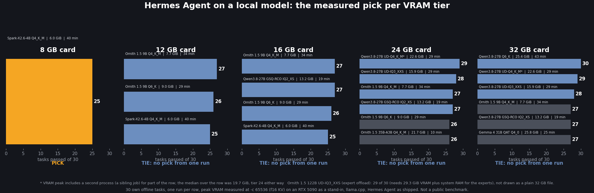

# Which local model for Hermes Agent at 8 / 12 / 16 / 24 / 32 GB: agenttest v2, lane L1

**The one line:** on 30 offline agent tasks run through Hermes Agent v0.22.2+2756.g9bda188, a 12 GB-class file (Ornith 1.5 9B Q4_K_M) passed 27 of 30 and the best 32 GB-class file (Qwen3.8-27B Q6_K) passed 30 of 30. From 12 GB up, the best files sit within 3 tasks of each other; every card above 8 GB is a pre-registered tie. One run per file.

## Best file that fits each card (64K context, default f16 KV cache)

| card | file | passed of 30 |
|---|---|---:|
| 8 GB | Spark-X2.6-4B Q4_K_M | 25 |
| 12 GB | Ornith 1.5 9B Q4_K_M | 27 |
| 16 GB | Qwen3.8-27B GSQ-RCO IQ2_XS (ties with Ornith 1.5 9B Q4_K_M at 27) | 27 |
| 24 GB | Qwen3.8-27B UD-Q4_K_M | 29 |
| 32 GB | Qwen3.8-27B Q6_K | 30 |

"Fits" = measured VRAM peak at 64K plus 768 MiB headroom is under the card size. Per card, a lead of fewer than 3 tasks over the next file is a TIE and no pick is made from one run (rule fixed before any model output, [`PREREG.md`](../agenttest/v2/PREREG.md)). Under that rule the 12, 16, 24 and 32 GB cards are each a tie (their top two files are within 2 tasks); the bullets above are the best-scoring file per card, not a pick.

Across cards: Qwen3.8-27B Q6_K (30) against Ornith 1.5 9B Q4_K_M (27) is a gap of 3 tasks. Paired per task, the 9B failed t06, t19, t23 and Q6_K passed all 30: 3/0 discordant, exact two-sided p 0.25. One run per file, so this is not decisive.

## All ten rows

| file | passed of 30 | tool calls | minutes for 30 tasks | decode tok/s p50 | VRAM peak MiB at 64K | tier | peak MiB, q8_0 KV | tier, q8_0 KV | file GB |
|---|---:|---:|---:|---:|---:|---:|---:|---:|---:|
| Qwen3.8-27B Q6_K | 30 | 253 | 43 | 60.0 | 26,034 | 32 | 24,322 | 32 | 22.88 |
| Qwen3.8-27B UD-Q4_K_M | 29 | 257 | 29 | 75.0 | 23,121 | 24 | 18,482 | 24 | 16.46 |
| Ornith 1.5 122B UD-IQ3_XXS (expert offload) | 29 | 236 | 52 | 44.8 | 30,026 | 32 | 29,286 | 32 | 49.52 |
| Qwen3.8-27B UD-IQ3_XXS | 28 | 260 | 29 | 88.6 | 16,322 | 24 | 14,606 | 16 | 11.91 |
| Qwen3.8-27B GSQ-RCO IQ2_XS | 27 | 239 | 19 | 106.2 | 13,498 | 16 | 11,778 | 16 | 8.42 |
| Gemma 4 31B QAT Q4_0 | 27 | 244 | 25 | 61.4 | 26,386 | 32 | 22,744 | 24 | 17.65 |
| Ornith 1.5 9B Q4_K_M | 27 | 514 | 34 | 196.0 | 7,844 | 12 | 7,092 | 8 | 5.63 |
| Ornith 1.5 35B-A3B Q4_K_M | 26 | 285 | 10 | 274.4 | 22,266 | 24 | 21,732 | 24 | 21.71 |
| Ornith 1.5 9B Q6_K | 26 | 347 | 29 | 169.2 | 9,242 | 12 | 8,492 | 12 | 7.36 |
| Spark-X2.6-4B Q4_K_M | 25 | 640 | 40 | 215.1 | 6,116 | 8 | 5,128 | 8 | 3.54 |

Speed and effort: Ornith 1.5 9B Q4_K_M made 514 tool calls for its 27; Qwen3.8-27B UD-Q4_K_M made 257 for its 29; Qwen3.8-27B Q6_K made 253 for its 30. The 9B decodes 2.6x faster than Qwen3.8-27B Q4_K_M (196.0 against 75.0 tok/s p50), so the 30 tasks took 34 min against 29 min; Q6_K took 43 min.

## Notes on single rows

- **Ornith 1.5 122B UD-IQ3_XXS (49.52 GB file, experts in system RAM):** 29 of 30, 30,026 MiB VRAM peak (tier 32), 44.8 tok/s p50, 3,102 s. It needs the 32 GB card plus system RAM for the experts, so it is not drawn as a plain 32 GB file on the card.
- **Qwen3.8-27B UD-IQ3_XXS (11.91 GB file):** passed 28 of 30. At 64K with the default cache its VRAM peak is 16,322 MiB, tier 24; with q8_0 KV it is 14,606 MiB, tier 16. Its score with q8_0 cache on these tasks was not measured.
- **Qwen3.8-27B UD-Q4_K_M:** the recorded VRAM peak (23,121 MiB) includes a second GPU process that was running for part of the row; the median of the row's samples is 20,194 MiB. The tier is 24 either way.
- **Spark-X2.6-4B** needs `reasoning_effort: high` (its template rejects Hermes' default `medium`), recorded as effort `high` in its row.

## Method

- **Tasks:** 30 frozen offline tasks (files 6, code 5, refactor 5, recovery 4, shell 3, data 3, long 4), each with a deterministic checker proved before any model output (empty folder, fresh seed and near miss fail; hand solution passes). Examples: a multi-file rename (t12), a real git merge conflict (t19), the first bad commit in a 14-commit history (t22), five bugs behind a 40-test suite (t30). Design, scoring and tie rule: [`agenttest/v2/PREREG.md`](../agenttest/v2/PREREG.md), written 2026-10-28.
- **Run:** Hermes Agent v0.22.2+2756.g9bda188 as shipped, one fresh session per task (`hermes chat -q`, stream-json), toolset hermes-cli, memory off, approvals at the default (headless blocks are counted, not hidden). llama.cpp `llama-server` build 11668, `-ngl 99 -fa on -c 65536 --jinja`, f16 KV. Each file ran at its maker's sampling settings (per-row source in [`rows.json`](../agenttest/v2/rows.json), checked against the server's `/props` before the first task). One RTX 5090 stands in for the smaller cards: peak VRAM bytes transfer to other CUDA cards, decode speed does not.
- **Scoring:** pass = checker true. Tool errors, approval blocks and malformed calls are counted separately in [`l1-readout.md`](../data/agenttest-v2-c1/l1-readout.md). Peak VRAM = nvidia-smi every 2 s over the row; the q8_0 columns come from a separate fit leg (one ~14k-token request at -c 65536, no tasks).
- **Pre-registered tie rule:** per card, a lead under 3 tasks of 30 is a tie. Spread test (Spark at 27+ of 30 = the set does not spread): Spark scored 25, flag not raised.

## Limits

30 own tasks, not a public benchmark. One sampled run per file: 1 to 2 tasks of difference is noise. The 5090 stands in for smaller cards. q8_0 KV accuracy on these tasks is untested (VRAM only). One Hermes Agent install (v0.22.2+2756.g9bda188); a newer release may behave differently. Failed tasks per file are in `rows/<file>.summary.json` (`per_task`).

## Files

- [`data/agenttest-v2-c1/l1-tier-table.csv`](../data/agenttest-v2-c1/l1-tier-table.csv), [`l1-tier-table.json`](../data/agenttest-v2-c1/l1-tier-table.json), [`l1-readout.md`](../data/agenttest-v2-c1/l1-readout.md): the aggregate (every number above and on the card).
- `data/agenttest-v2-c1/rows/<file>.summary.json`: per-file summaries (per-task pass, tool calls, wall, VRAM, sampling applied, llama.cpp and Hermes versions).
- [`agenttest/v2/`](../agenttest/v2/README.md): tasks, checkers, runner, aggregate, [`chart_l1_tiers.py`](../agenttest/v2/chart_l1_tiers.py) (the card: `--hide-offload --mark qwen38-27b-ud-q4km=...`).
- Card: `reports/agenttest-v2-vram-tiers.png`.
