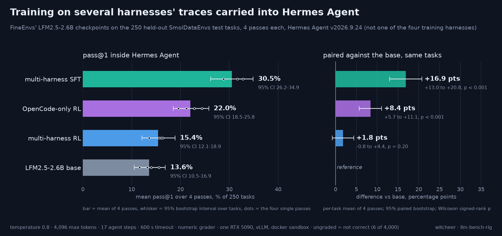

# Multi-harness checkpoints inside Hermes Agent: FineEnvs' LFM2.5-2.6B family on 250 held-out data tasks

**Inside Hermes Agent, FineEnvs' multi-harness SFT checkpoint of LFM2.5-2.6B solves 30.5% of 250 held-out data-analysis tasks against 13.6% for the base model (+16.9 points, 95% CI +13.0 to +20.8, four passes each); OpenCode-only RL adds 8.4 points and multi-harness RL 1.8, the last within noise.**

**Rig:** RTX 5090 32GB (capsule), vLLM serving one checkpoint at a time (tensor parallel 1, data parallel 1, bf16) · **Window:** 2026-10-07 to 2026-10-10, inside the box's cheap-electricity hours · **Harness:** Hermes Agent v2026.9.24[9] driven by the FineEnvs evaluator (`05-multi-harness-rl/eval/evaluate_hrl.py`, repo pinned at 6f2b6137)[2] · **Data:** [`dataset/hermes_harness_transfer.csv`](../dataset/hermes_harness_transfer.csv) · **Chart:** [`hermes-harness-transfer.png`](hermes-harness-transfer.png)

## TL;DR

1. **Multi-harness SFT carries into Hermes Agent.** 30.5% mean pass@1 (305 of 1,000 task-passes) against 13.6% for the base (136 of 1,000). Paired on the same tasks: +16.9 points, better on 110 tasks, worse on 19, Wilcoxon signed-rank p ≈ 1.5e-13. It beats the base in all four passes, and pass-by-pass McNemar is significant every time (pass 1: 54 gained, 14 lost, exact p ≈ 1.1e-6).
2. **OpenCode-only RL moves it too, by half as much.** 22.0% (220 of 1,000), +8.4 points (95% CI +5.7 to +11.1), better on 78 tasks and worse on 22, Wilcoxon p ≈ 1.7e-8. A single pass did not show it (pass 1 McNemar 23/13, p = 0.13); the four-pass mean does.
3. **Multi-harness RL stays close to the base.** 15.4% (154 of 1,000), +1.8 points with a 95% CI of -0.8 to +4.4, Wilcoxon p = 0.20. Better on 41 tasks, worse on 30.

## What this measures

FineEnvs' multi-harness RL write-up[1] trains Liquid AI's LFM2.5-2.6B[3] and publishes the checkpoints. The four run here:

- **base:** LFM2.5-2.6B as released by Liquid AI.[3]
- **multi-harness RL:** RL inside four harnesses at once (OpenCode, Claude Code, Codex, Mini-SWE-Agent).[4]
- **OpenCode-only RL:** the same RL recipe inside OpenCode alone.[5]
- **multi-harness SFT:** supervised fine-tuning on a Qwen3.8-27B teacher's successful rollouts from the same four harnesses.[6][7]

Hermes Agent is not one of those four training harnesses. This report asks one question: which of those training recipes carries over into a harness the fine-tuning never used?

Every number below is a checkpoint compared with another checkpoint inside the same harness. It is not a harness comparison and should not be read next to the article's per-harness scores: the sandbox, the serving stack and the harness all differ. One detail matters for reading the base row: Liquid AI trained the base model inside several harnesses, and names Hermes Agent and OpenClaw among them[8][1]. Hermes Agent is new to the FineEnvs fine-tuning stage, not to the base model.

## Setup

- **Tasks:** the 250 held-out SmolDataEnvs test tasks (33 easy, 118 medium, 99 hard), data-analysis questions built from Kaggle notebooks, with no overlap in notebook, question or instruction with the 1,000 training tasks[1]. Prepared with the FineEnvs `prepare.py` (hash-checked).
- **Protocol (FineEnvs evaluator, unchanged):** temperature 0.8, top_p 1.0, 4,096 max output tokens, 17 agent steps, 600 s agent timeout, one attempt per task per pass, numeric grader writing one float per task (`correctness >= 1.0` counts as correct)[2].
- **Our deltas from the FineEnvs setup:** a local docker sandbox instead of a hosted one; vLLM on one card (DP1) instead of two; Hermes Agent pinned to release tag v2026.9.24 and baked into the task image once, so every trial starts from the same install.
- **Checkpoints (Hugging Face revisions, all equal to `main` on 2026-10-11):** `LiquidAI/LFM2.5-2.6B@654f9463` · `FineEnvs/LFM2.5-2.6B-multiharness-RL@3c1e3522` · `FineEnvs/LFM2.5-2.6B-opencode-RL@a0bcdab2` · `FineEnvs/LFM2.5-2.6B-multiharness-SFT@748e2377`. The two RL repos' `main` is step 1,000; the article's best checkpoints sit on `step-700` and `step-900` branches[1] and were not run here.
- **Passes:** four independent passes per checkpoint over the same 250 tasks (16 runs, 4,000 task-passes). The evaluator samples at temperature 0.8 with no seed, so each pass is a fresh sample. Pass 1 ran 2026-10-07/08, passes 2 to 4 on 2026-10-10, pass-major order (all four checkpoints per pass before the next pass).
- **Denominator rule:** a task-pass with no grade counts as not correct, over 250 per pass. This is the headline. The graded-only rate (correct / graded) is in the table and the csv. Six of 4,000 task-passes have no grade; see below.
- **Statistics:** the per-task score is the mean of its four passes. The 95% interval on each checkpoint is a percentile bootstrap over the 250 tasks (20,000 resamples). Paired comparison against the base uses the per-task difference of those means: a 95% paired bootstrap interval, a Wilcoxon signed-rank test (zero differences dropped, tie-corrected normal approximation) and a sign-flip permutation test (20,000 flips; its floor is p ≈ 5e-5). Exact McNemar per pass is reported alongside.
- Everything was recomputed from the 4,000 per-task pair files (`pairs/*.json`, one per task per run), not from the evaluator's summaries.

## Results

| Checkpoint | Correct / 1,000 | Mean pass@1 | 95% CI | Graded-only | Pass 1 | Pass 2 | Pass 3 | Pass 4 | Tasks solved at least once |
|---|---:|---:|---:|---:|---:|---:|---:|---:|---:|
| LFM2.5-2.6B base | 136 | **13.6** | 10.5 to 16.9 | 13.6 (136/1,000) | 15.6 | 14.0 | 11.6 | 13.2 | 67 |
| multi-harness RL | 154 | **15.4** | 12.1 to 18.9 | 15.5 (154/996) | 16.0 | 16.4 | 15.6 | 13.6 | 75 |
| OpenCode-only RL | 220 | **22.0** | 18.5 to 25.8 | 22.0 (220/1,000) | 19.6 | 24.4 | 21.2 | 22.8 | 113 |
| multi-harness SFT | 305 | **30.5** | 26.2 to 34.9 | 30.6 (305/998) | 31.6 | 28.8 | 32.8 | 28.8 | 137 |

Percentages. Per-pass columns are k/250 with ungraded counted as not correct. Tasks solved in all four passes: base 3, multi-harness RL 8, OpenCode-only RL 8, multi-harness SFT 25.

### By difficulty

| Checkpoint | Easy (33 tasks, 132 passes) | Medium (118, 472) | Hard (99, 396) |
|---|---:|---:|---:|
| LFM2.5-2.6B base | 28.0 (37) | 13.3 (63) | 9.1 (36) |
| multi-harness RL | 27.3 (36) | 15.9 (75) | 10.9 (43) |
| OpenCode-only RL | 34.8 (46) | 25.2 (119) | 13.9 (55) |
| multi-harness SFT | 62.9 (83) | 32.4 (153) | 17.4 (69) |

Mean pass@1 in percent, correct task-passes in brackets. Bootstrap intervals per slice are in the csv; the easy slice is 33 tasks, so its intervals are wide (base 17.4 to 38.6, SFT 52.3 to 73.5).

### Paired against the base

| Checkpoint | Difference (points) | 95% paired CI | Tasks better / worse / tied | Wilcoxon p | Sign-flip p | McNemar by pass, gained/lost (exact p) |
|---|---:|---:|---:|---:|---:|---|
| multi-harness RL | +1.8 | -0.8 to +4.4 | 41 / 30 / 179 | 0.20 | 0.21 | 17/16 (1.0) · 23/17 (0.43) · 22/12 (0.12) · 23/22 (1.0) |
| OpenCode-only RL | +8.4 | +5.7 to +11.1 | 78 / 22 / 150 | 1.7e-8 | < 1e-4 | 23/13 (0.13) · 43/17 (0.001) · 37/13 (0.0009) · 36/12 (0.0007) |
| multi-harness SFT | +16.9 | +13.0 to +20.8 | 110 / 19 / 121 | 1.5e-13 | < 1e-4 | 54/14 (1.1e-6) · 50/13 (3.0e-6) · 63/10 (1.6e-10) · 50/11 (4.6e-7) |

### Ungraded task-passes

Six of 4,000 task-passes have no grade: one in multi-harness RL pass 2, three in multi-harness RL pass 3, two in multi-harness SFT pass 2. In all six the trial record shows the same thing: the sandbox's healthcheck, which downloads the task's input files into the container (`pull_bucket.py`), hit Harbor's 180 s command limit before the agent started, so the model never saw the task and there is no answer to grade. They count as not correct in the headline. That is why the evaluator's own summaries read 0.1647 (41/249), 0.1579 (39/247) and 0.2903 (72/248) for those three runs: the summaries divide by graded tasks. Counting them as not correct moves multi-harness RL from 15.5 to 15.4 and multi-harness SFT from 30.6 to 30.5; no comparison changes.

One more task-pass was ungraded on the first try: OpenCode-only RL pass 1, task `0000_774_774985_qa_2`. It was re-run once on 2026-10-08, before passes 2 to 4 started, and graded correct. It is the only re-run in the set. Without it, OpenCode-only RL reads 21.9 instead of 22.0.

## Reads

1. **The SFT checkpoint is the clear result.** It more than doubles the base inside Hermes Agent, it does so in every pass (28.8 to 32.8 against the base's 11.6 to 15.6), and the gain holds on every difficulty slice. On hard tasks it goes from 9.1 to 17.4. It also solves 137 distinct tasks at least once against the base's 67, and solves 25 tasks in all four passes against 3.
2. **The training data is the likely difference, not the method name.** Multi-harness SFT learned from 3,189 successful teacher rollouts across four harnesses, shuffled together[1]. Multi-harness RL learned from the model's own rollouts in the same four harnesses. Inside Hermes Agent the first carried over and the second mostly did not. Why is not tested here; teacher traces covering more ways of finishing a task is one candidate.
3. **OpenCode-only RL beats multi-harness RL inside Hermes Agent.** 22.0 against 15.4, and the gap shows on easy, medium and hard alike. Both are the step-1,000 checkpoints. This is one seed per recipe, so it says which published checkpoint transfers better, not which recipe does.
4. **A single pass would have hidden the RL result.** Pass 1 alone gave OpenCode-only RL 49 against 39 (McNemar p = 0.13). Passes 2 to 4 each came out significant, and the four-pass mean is clear. At temperature 0.8 a single 250-task pass moves by up to 4.8 points between passes of the same checkpoint (OpenCode-only RL, 19.6 to 24.4), so one pass is enough for a 17-point gap and not enough for an 8-point one.
5. **Absolute numbers are the size of the model on these tasks.** A 2.6B model on multi-step data analysis with a 17-step budget solves around one task in seven in its base form; the base row is the reference here, and every claim is a difference from it on the same tasks, in the same harness, with the same sandbox.

## Honest limits

- One harness version (Hermes Agent v2026.9.24), one serving stack, one card. A different Hermes Agent release, sandbox or serving setup could move all four rows.
- One published checkpoint per recipe, one seed each, as released. The RL repos' `main` is step 1,000; the best-scoring branches from the article (step 700, step 900) were not run.
- Four passes per checkpoint at temperature 0.8. The intervals cover task sampling and the four draws; they do not cover training-seed variance.
- Our sandbox (local docker) and serving (vLLM DP1) differ from the FineEnvs setup. The protocol fields that set the task (instructions, step limit, timeout, output cap, temperature, grader) are the evaluator's own, unchanged.
- Six of 4,000 task-passes ungraded (input-file download timed out before the agent started) and counted as not correct; one pass-1 task re-run once. Both are listed above with their effect.
- Not a harness ranking. The numbers here are not comparable with any per-harness number in the FineEnvs article.

## Files

- [`dataset/hermes_harness_transfer.csv`](../dataset/hermes_harness_transfer.csv): one row per checkpoint and slice (all / easy / medium / hard), with counts, graded and ungraded, mean pass@1, bootstrap intervals, per-pass rates, paired difference, Wilcoxon and sign-flip p, tasks better/worse and pass-1 McNemar.
- Raw: `~/harness-rl/runs/full-<ckpt>[-r2|-r3|-r4]-n250/pairs/*.json` on the rig (keys `task, difficulty, correctness, tool_calls, generated_tokens, prompt_tokens, seconds`; ungraded rows carry `error, detail`), plus each run's `trials/` directory with the Harbor trial records.

## Sources

[1] FineEnvs, The ultimate guide to multi-harness RL (results compiled through 2026-09-29, updated 2026-10-01) - https://huggingface.co/spaces/FineEnvs/multi-harness-rl
[2] FineEnvs repo (05-multi-harness-rl, eval/evaluate_hrl.py), pinned 6f2b6137 - https://github.com/adithya-s-k/FineEnvs
[3] LiquidAI/LFM2.5-2.6B - https://huggingface.co/LiquidAI/LFM2.5-2.6B
[4] FineEnvs/LFM2.5-2.6B-multiharness-RL - https://huggingface.co/FineEnvs/LFM2.5-2.6B-multiharness-RL
[5] FineEnvs/LFM2.5-2.6B-opencode-RL - https://huggingface.co/FineEnvs/LFM2.5-2.6B-opencode-RL
[6] FineEnvs/LFM2.5-2.6B-multiharness-SFT - https://huggingface.co/FineEnvs/LFM2.5-2.6B-multiharness-SFT
[7] FineEnvs/SmolDataEnvs-multiharness-sft (the SFT data) - https://huggingface.co/datasets/FineEnvs/SmolDataEnvs-multiharness-sft
[8] Liquid AI, LFM2.5-2.6B release post - https://www.liquid.ai/blog/lfm2-5-2-6b
[9] Hermes Agent release v2026.9.24 - https://github.com/NousResearch/hermes-agent/releases/tag/v2026.9.24
