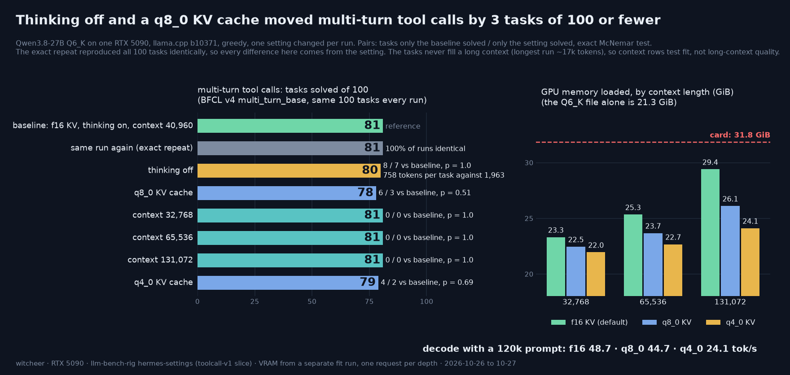

# hermes-settings: do thinking, KV cache type and context size change tool calling on a local model? Qwen3.8-27B Q6_K on one RTX 5090

**The one line:** on the same 100 multi-turn tool-call tasks, no setting moved the score by more than 3 tasks and none is distinguishable from chance: thinking off 80 (against 81 with thinking on), q8_0 KV cache 78, q4_0 KV cache 79, context 32k / 64k / 128k 81 / 81 / 81. The unchanged setup run a second time reproduced all 100 tasks exactly. What the settings do change is cost: thinking off writes 61% fewer tokens, a 128k context fits in 29.4 GiB of the card's 31.8 with the default f16 cache, q8_0 saves 3.3 GiB of that for 8% slower decode at a 120k prompt, and q4_0 saves 5.3 GiB and halves decode at 120k.

**Rig:** RTX 5090 32GB (capsule), llama-server batch 1 · **Window:** three heures-creuses blocks, 2026-10-26 14:10 to 2026-10-27 16:33 CET (idle-queue item `70-hermes-settings`) · **Harness:** the toolcall-v1 driver ([`toolcall/`](../toolcall/README.md)), unchanged · **Data:** [`dataset/hermes_settings.csv`](../dataset/hermes_settings.csv) and three companion csvs · **Chart:** [`hermes-settings.png`](hermes-settings.png)



The right panel's vertical axis starts at 18 GiB, not 0: read the bar labels, not the heights.

## TL;DR

1. **No setting changed the multi-turn score by an amount 100 tasks can see.** Tasks solved of 100 (BFCL v4 `multi_turn_base`, thinking on, greedy): baseline 81, thinking off 80, q8_0 KV cache 78, q4_0 KV cache 79, context 32,768 / 65,536 / 131,072 all 81. Paired on the same 100 tasks (baseline-only solved / setting-only solved): thinking off 8 / 7 (exact McNemar p = 1.0), q8_0 6 / 3 (p = 0.508), q4_0 4 / 2 (p = 0.688), every context size 0 / 0. The largest drop is 3 tasks (q8_0). On the 899 one-step calls q8_0 scored 792 against 794 (10 / 8, p = 0.815) and thinking off 779 against 794 (54 / 39, p = 0.146): lower, inside noise.
2. **The baseline is deterministic, so every pair is read against zero run-to-run noise.** An exact repeat of the baseline flags gave 899 of 899 one-step replies byte-identical and 100 of 100 multi-turn tasks identical, scores 794 = 794 and 81 = 81. A q8_0 cache does change the model's greedy path (6% of multi-turn tasks and 46.3% of one-step replies identical to baseline) while leaving the outcomes level; q4_0 leaves no multi-turn task identical.
3. **Thinking off is the large saving.** Multi-turn: 758 completion tokens per task against 1,963 (61.4% fewer), 24.3 minutes of request time for the 100 tasks against 60.0, for 80 against 81 solved. One-step calls: 113.1 tokens against 302.1 (62.6% fewer).
4. **A 128k context fits, and the cache type decides the margin.** VRAM after load at `--ctx-size 131072`: 30,104 MiB (29.4 GiB) with f16, 26,734 MiB (26.1 GiB) with q8_0, 24,686 MiB (24.1 GiB) with q4_0, on a card with 32,607 MiB. Decode with a 120k prompt: f16 48.7 tok/s, q8_0 44.7, q4_0 24.1. The context legs of the accuracy test are a null by construction (the longest run is 17,452 tokens), so the fit run, not the score, is what the 32k / 64k / 128k comparison is about.

## Setup

- **Question:** what a person running Hermes Agent against a local llama-server would change first, and whether it costs tool-calling accuracy: thinking on or off, the KV cache type (f16 default, q8_0, q4_0), and the context size (32k, 64k, 128k). One setting changes per leg; everything else is the toolcall-v1 Q6_K baseline row.
- **Model:** Qwen3.8-27B Q6_K, 22,884,408,288 bytes (22.9 GB, 21.3 GiB, `stat -L`), the same file as the Q6_K row of [`reports/toolcall-v1.md`](toolcall-v1.md).
- **Binary:** mainline llama.cpp b10371 (`5d16e81dd`), the build the toolcall-v1 baselines ran on (`build_info` in every leg's `props.json` reads `b10371-5d16e81dd`).
- **Server line:** `llama-server -m <Q6_K> --n-gpu-layers 99 --host 127.0.0.1 --jinja --ctx-size N`, plus `--cache-type-k Q --cache-type-v Q` on the q8_0 and q4_0 legs. `--parallel` and `--flash-attn` are left at their defaults: the logs show 4 slots with a unified KV cache (`n_slots = 4, kv_unified = true`) on every leg, baselines included, and the driver sends one request at a time. Flash attention is left at `auto` on every leg. The item records the cache type and flash-attention setting in each leg's `server_bin` field.
- **Slice and driver:** the frozen toolcall-v1 slice of BFCL v4, unchanged: the 899 unique single-turn requests (S1 to S4) and 100 multi-turn tasks (S5, `multi_turn_base`), raw `/completion` mode, the official Qwen3.8 chat template rendered client-side, parser `toolcall-v1-parser-2`, BFCL's checkers. Greedy (temperature 0), `max_tokens` 16,384, one run per leg. Single-turn `ctx` 24,576, S5 `ctx` 40,960 unless the leg is a context leg. Tokenisation parity against the HF tokenizer: 1,998 of 1,998 prompts identical on every leg of this item. Setup detail is in [`reports/toolcall-v1.md`](toolcall-v1.md).
- **Thinking off:** set in the rendered chat template (the same switch as the toolcall-v1 `st-off` row), not through Hermes Agent's own reasoning setting; see the limits.
- **Baselines (not re-run here):** the three toolcall-v1 Q6_K legs from 2026-10-24, KV f16: `st-on` (794 of 899 unique requests, 799 of 906 scored), `st-off` (779 of 899, 784 of 906), `s5-on` (81 of 100). Every leg below is paired against its own baseline, item by item, on BFCL id.
- **Legs:**

| Leg | What changed | KV cache | `--ctx-size` | Slice | Thinking |
|---|---|---|---:|---|---|
| `s5-on-f16-r2`, `st-on-f16-r2` | nothing (exact repeat of the baseline flags) | f16 | 40,960 / 24,576 | S5 / S1 to S4 | on |
| `s5-on-q8`, `st-on-q8` | KV cache type | q8_0 | 40,960 / 24,576 | S5 / S1 to S4 | on |
| `s5-on-q4` | KV cache type | q4_0 | 40,960 | S5 | on |
| `s5-off-f16` | thinking | f16 | 40,960 | S5 | off |
| `s5-on-f16-c32k`, `-c64k`, `-c128k` | context size | f16 | 32,768 / 65,536 / 131,072 | S5 | on |
| `fit` | KV type x context: VRAM, speed at depth, passkey | f16, q8_0, q4_0 | 32,768 / 65,536 / 131,072 | none (synthetic prompts) | off |

- **Fit leg:** each of the nine (KV type, context) cells gets its own server. VRAM is `nvidia-smi` `memory.used` for the whole card (nothing else resident) right after load and again after the deepest request. The 131,072 cells then run six requests: a 64-token prompt, and prompts of about 8k, 32k, 65k, 120k tokens and a second 120k prompt (`cache_prompt` false, greedy, 87 generated tokens each, thinking off). Each prompt is a seeded pseudo-log (hex ids and keywords) with a passkey line at 50% depth (10% for the second 120k prompt); token counts are set with the server's own `/tokenize`. The 32,768 and 65,536 cells run one 229-token request each. Prefill and decode tok/s are the server's own `timings`. Script: [`toolcall/hermes_settings_fitdepth.py`](../toolcall/hermes_settings_fitdepth.py).
- **Paired tests:** exact two-sided binomial (McNemar) on the discordant items. "Identical" is the item's own definition: single-turn, the same generated text; multi-turn, the same per-step completion-token sequence and the same decoded calls. Script: [`toolcall/hermes_settings_paired.py`](../toolcall/hermes_settings_paired.py); [`scripts/hermes_settings_table.py`](../scripts/hermes_settings_table.py) re-derives every pair from the per-task outcomes and checks it against the item's own readout (12 of 12 lines match).
- **Run window:** all times CET (clocks changed on 2026-10-25). Block 1, Mon 2026-10-26 14:10 to 17:07: `fit` (14:10 to 14:21), `s5-off-f16`, `s5-on-q8`, `s5-on-f16-r2`, and the first 276 of 899 requests of `st-on-q8`. Block 2, Tue 2026-10-27 02:20 to 06:06: the rest of `st-on-q8`, `st-on-f16-r2`, `s5-on-f16-c32k`, and 83 of 100 tasks of `s5-on-f16-c64k`. Block 3, Tue 14:10 to 16:33: the last 17 tasks of `c64k`, then `c128k` and `q4_0`. The box's resident server was drained for each block and restored by the script's exit trap. Two legs therefore span a hard stop and were resumed on a fresh server process (`st-on-q8`, `c64k`); see the resume section.

## Results: multi-turn tool calls (S5, 100 tasks, thinking on unless stated)

| Leg | Solved of 100 | Wilson 95% | Baseline-only / leg-only | McNemar p | Identical to baseline | Mean completion tokens | Request time, 100 tasks | Longest run (prompt + generated) |
|---|---:|---:|---:|---:|---:|---:|---:|---:|
| Baseline (f16, ctx 40,960) | **81** | 72.2 to 87.5 | reference | | | 1,962.5 | 60.0 min | 14,951 |
| Exact repeat | **81** | 72.2 to 87.5 | 0 / 0 | 1.0 | 100% | 1,962.5 | 58.3 min | 14,951 |
| Thinking off | **80** | 71.1 to 86.7 | 8 / 7 | 1.0 | 0% | 758.3 | 24.3 min | 10,047 |
| KV cache q8_0 | **78** | 68.9 to 85.0 | 6 / 3 | 0.508 | 6% | 1,912.7 | 57.6 min | 16,319 |
| KV cache q4_0 | **79** | 70.0 to 85.8 | 4 / 2 | 0.688 | 0% | 1,953.0 | 67.0 min | 17,452 |
| Context 32,768 | **81** | 72.2 to 87.5 | 0 / 0 | 1.0 | 100% | 1,962.5 | 58.1 min | 14,951 |
| Context 65,536 † | **81** | 72.2 to 87.5 | 0 / 0 | 1.0 | 84% | 1,984.2 | 58.9 min | 15,833 |
| Context 131,072 | **81** | 72.2 to 87.5 | 0 / 0 | 1.0 | 100% | 1,962.5 | 58.3 min | 14,951 |

q4_0 against q8_0, the pair the first two tests do not cover: 79 against 78, 3 / 4 discordant (q8_0-only / q4_0-only), p = 1.0, 1% identical. No leg had a force-quit task or a context-limited task, and no final `summary.json` records a transport error (a resumed leg's summary covers its last session only). Request time is the sum of per-task wall time (server load and the paired readout are not in it). † 16 of the 100 tasks are not identical because the leg was resumed after a hard stop; see below. Wilson intervals on 100 tasks are about 15 points wide and overlap across the whole 78 to 81 range.

## Results: one-step calls (S1 to S4, 899 unique requests, thinking on unless stated)

| Leg | Solved of 899 (of 906 scored) | Wilson 95% | Baseline-only / leg-only | McNemar p | Identical to baseline | Mean completion tokens | Request time |
|---|---:|---:|---:|---:|---:|---:|---:|
| Baseline (f16, ctx 24,576) | **794** (799) | 86.1 to 90.3 | reference | | | 302.1 | 78.9 min |
| Exact repeat | **794** (799) | 86.1 to 90.3 | 0 / 0 | 1.0 | 100% | 302.1 | 77.0 min |
| KV cache q8_0 ‡ | **792** (796) | 85.8 to 90.1 | 10 / 8 | 0.815 | 46.3% | 283.0 | 73.1 min |
| Thinking off (toolcall-v1 `st-off`, 2026-10-24) | **779** (784) | 84.3 to 88.7 | 54 / 39 | 0.146 | 0% | 113.1 | 32.2 min |

By set, in the 906-item convention of [`reports/toolcall-v1.md`](toolcall-v1.md) (S1 parallel 439, S2 nested 67, S3 controls 300, S4 abstain 100): baseline 384 / 57 / 279 / 79, repeat 384 / 57 / 279 / 79, q8_0 383 / 55 / 280 / 78, thinking off 357 / 61 / 292 / 74. The thinking-off row was run on 2026-10-24 as part of toolcall-v1, not in this item; the pair above is computed here with the same script on the two baseline directories ([`dataset/hermes-settings/paired-single-turn-on-vs-off.txt`](../dataset/hermes-settings/paired-single-turn-on-vs-off.txt)). ‡ `st-on-q8` was resumed after a hard stop; the identical share is 46.4% before the resume point and 46.2% after it, so the resume does not explain it. Single-turn q4_0 and the single-turn context legs were not run.

## Results: what the context and cache type cost (the `fit` leg)

VRAM in MiB (GiB) after load, whole card, 4 slots, flash attention auto, one load per cell. The card has 32,607 MiB (31.8 GiB).

| KV cache | ctx 32,768 | ctx 65,536 | ctx 131,072 | Peak seen after the 120k requests |
|---|---:|---:|---:|---:|
| f16 (default) | 23,864 (23.3) | 25,944 (25.3) | 30,104 (29.4) | 30,136 |
| q8_0 | 22,990 (22.5) | 24,238 (23.7) | 26,734 (26.1) | 26,766 |
| q4_0 | 22,478 (22.0) | 23,214 (22.7) | 24,686 (24.1) | 24,718 |

At 131,072 f16 leaves 2,503 MiB (2.4 GiB) after load and 2,471 MiB after the 120k requests; q8_0 saves 3,370 MiB (3.3 GiB) against f16 and q4_0 5,418 MiB (5.3 GiB). The VRAM difference between the 131,072 and 32,768 loads, divided by the 98,304 extra tokens, is 65.0 KiB per token for f16, 39.0 for q8_0 and 23.0 for q4_0 (it includes any compute-buffer growth with context, so it is an upper bound on the cache itself). The Q6_K file alone is 21.3 GiB.

Speed at depth in the 131,072 cells, prefill / decode tok/s, one request per depth, depth in prompt tokens as counted by the server:

| KV cache | 64 tokens (decode only) | 8,178 | 32,745 | 65,598 | 120,109 | 120,190 (passkey at 10%) |
|---|---:|---:|---:|---:|---:|---:|
| f16 | 63.3 | 3,198 / 61.5 | 2,922 / 58.2 | 2,451 / 54.3 | 1,829 / 48.7 | 1,822 / 48.7 |
| q8_0 | 62.3 | 3,124 / 60.9 | 2,859 / 56.5 | 2,335 / 51.5 | 1,740 / 44.7 | 1,739 / 44.8 |
| q4_0 | 59.9 | 3,121 / 55.6 | 2,859 / 43.0 | 2,335 / 33.4 | 1,742 / 24.1 | 1,742 / 24.1 |

Against f16, q8_0 decodes 1.0% slower at 8k, 3.0% at 32k, 5.1% at 65k and 8.2% at 120k, and prefills 2 to 5% slower. q4_0 decodes 9.5% slower at 8k, 26.1% at 32k, 38.4% at 65k and 50.4% at 120k (24.14 against 48.67 tok/s), with prefill within 5% of q8_0. A 120k prompt on f16 took 65.7 s to first token. The passkey was recovered in all 24 requests of the fit leg (one needle per request, a smoke check and not a score). The 32,768 and 65,536 cells ran one short request each, so they say what fits and not how fast.

## Noise, repeats and the resume artefact

- **Protocol.** `s5-on-f16-r2` and `st-on-f16-r2` re-run the baseline flags exactly (same binary, same server line, same prompts). The paired reader reports, for each pair, the discordant counts, the exact McNemar p and the share of byte-identical outputs. Run against itself the baseline reads 899 of 899 and 100 of 100 identical. That makes greedy decoding on this stack deterministic for an unchanged server configuration, and it means a difference between legs is a change in the model's path, not run noise. It does not make a 3-task gap meaningful: a changed path can flip a task either way, and the McNemar test is what says whether the flips lean in one direction. Here none do.
- **Resume artefact on `c64k`.** The context 65,536 leg is 84% identical to the baseline, not 100%, while the 32,768 and 131,072 legs are 100%. The leg was stopped by the block's hard stop at 06:06 CET with 83 of 100 tasks done and resumed on a new server process at 14:10. All 16 non-identical tasks sit at file positions 83 and 85 to 99, which is the part written after the resume (position 84 happens to be identical); positions 0 to 82 are identical to the baseline, and the outcome (solved or not) is the same on all 16, so the solved count and the discordant counts are unchanged (81 against 81, 0 / 0). Mean completion tokens move from 1,962.5 to 1,984.2 for the same reason. The cause was not isolated: a fresh server process with a cold prompt cache is the obvious candidate and not a tested one. The practical rule is that identity rates from a resumed leg are not comparable with those from an unbroken leg. `st-on-q8` was also resumed, once, at task 276 of 899; its identical share is the same on both sides of that point.

## Reads

1. **The honest summary is "no measurable difference at this size", not "no difference".** With 100 tasks and 6 to 15 discordant tasks per multi-turn pair, p < 0.05 needs a lopsided split: at 15 discordant tasks (thinking off) the smallest split that clears it is 12 / 3, a 9-task gap; at 9 discordant (q8_0) it is 8 / 1. The data are consistent with no effect and with an effect of a few tasks either way. The one-step set has 899 requests and is finer: q8_0 is 2 requests lower (p = 0.815) and thinking off 15 lower (p = 0.146), neither separable from chance.
2. **Thinking off cost nothing measurable on multi-turn and saved most of the time.** 80 against 81 solved, 758 tokens per task against 1,963, 24.3 minutes against 60.0, and the longest run drops from 14,951 to 10,047 tokens. On one-step calls the same switch is 15 requests lower (779 against 794); that is inside noise and it points down, so it is a lean to keep in view and not a finding. The file matters: in [`reports/toolcall-v1.md`](toolcall-v1.md) the GSQ-RCO IQ2_XS file drops from 88.9 to 76.6 on one-step calls without thinking, so this read is for the Q6_K file and says nothing about other quants.
3. **A quantised KV cache changes the path, not the outcome count, at this n.** q8_0 left 6% of multi-turn tasks and 46.3% of one-step replies identical to f16, and q4_0 left 0% of multi-turn tasks identical, yet the solved counts moved by 3 and 2 tasks (p = 0.508, 0.688). Mean completion tokens barely move (1,912.7 and 1,953.0 against 1,962.5). A quantised cache is therefore not a bit-exact swap, and a benchmark rerun after changing it is a new run, not a repeat.
4. **Context size is free in score and costly in memory.** 32k, 64k and 128k solve the same 81 tasks with no discordant task, because no task in the slice needs more than 17,452 tokens; the allocation changes nothing the model sees. The cost is VRAM: f16 grows from 23.3 GiB at 32,768 to 29.4 GiB at 131,072, so 128k fits on a 32 GB card with 2.4 GiB to spare and leaves little room for anything else on the GPU. q8_0 returns 3.3 GiB at 128k.
5. **q4_0 saves the most memory and pays in speed that grows with depth.** At an 8k prompt q4_0 decodes 9.5% slower than f16, at 120k 50.4% slower, so its price depends on how long the agent's conversations get. q8_0's price is 1% to 8% over the same range. Neither was measurably worse on score.
6. **The speed cost of depth exists for every cache type.** f16 decode falls from 61.5 tok/s at 8k to 48.7 at 120k (20.9% lower) and prefill from 3,198 to 1,829 tok/s, so a 120k prompt is about 66 s to first token on this card.

## Using this with Hermes Agent

These legs were driven by the toolcall-v1 harness, not by Hermes Agent. Two Hermes Agent settings are relevant and both are documented (live docs read 2026-10-27): `model.context_length` in `config.yaml` is an explicit pin that always wins over provider metadata ([providers: context length detection](https://hermes-agent.nousresearch.com/docs/integrations/providers)), and `/reasoning none` disables reasoning for the session (add `--global` to persist it to `config.yaml`; [configuration: reasoning effort](https://hermes-agent.nousresearch.com/docs/user-guide/configuration)). For a llama-server you run yourself, the matching server flags are `--ctx-size 131072` and `--cache-type-k q8_0 --cache-type-v q8_0`. UNVERIFIED: that `/reasoning none` makes llama-server think off the same way the chat-template switch used here does; it was not tested, so check completion token counts on your own setup.

## Worth it if / not if

- **Worth it if** you run a 27B-class model behind Hermes Agent on a 32 GB card: the default f16 cache already holds a 128k context, and q8_0 gives back 3.3 GiB at 128k for a score change this test cannot separate from chance and an 8% decode slowdown at the deepest prompt.
- **Worth it if** tool-call turns feel slow and you run this Q6_K file: thinking off kept the multi-turn score level here at 39% of the tokens. Check it on your own file and tasks first.
- **Not if** you want a long-context accuracy answer: nothing here fills a long context.
- **Not if** you expect q4_0 to be a free memory saver on long conversations: decode halves at a 120k prompt.
- **Not if** you read "no measurable difference" as "no difference": 100 tasks cannot see a gap of a few tasks.

## Honest limits

- **n = 100 multi-turn tasks** (Wilson intervals about 15 points wide) and 899 one-step requests, greedy, one run per leg. The paired tests treat each task as one independent draw. The comparisons against the baseline are unadjusted; none reaches p < 0.05, so no correction changes a conclusion.
- **No long-context fill.** The longest multi-turn run in any leg is 17,452 prompt plus generated tokens (q4_0; c64k 15,833, q8_0 16,319, baseline 14,951), and the longest one-step prompt is 6,140 tokens. The context legs test that the allocation loads and changes nothing at normal lengths; they say nothing about answer quality at 64k or 128k. The passkey check is one needle per request.
- **BFCL's tools, not Hermes Agent's.** The tasks use BFCL v4's function schemas, state checker and prompts through the toolcall-v1 raw-mode harness, not Hermes Agent's own toolset, system prompt or memory. No Hermes Agent session was run in this study.
- **One model and one quant.** Qwen3.8-27B Q6_K only. A smaller quant may react differently to a quantised cache or to thinking off (see read 2).
- **Thinking off through the template.** Set by the chat-template render, not through Hermes Agent's reasoning setting or llama-server's `--reasoning` flag.
- **Server regime.** Default `--parallel` (4 slots, unified KV), flash attention auto, one stream, the board binary. A server that also runs a draft model, a different parallel setting or another binary is a different regime and was not tested. Single-turn q4_0 and single-turn context legs were not run.
- **Fit numbers are one request per depth** on an otherwise empty card; VRAM is whole-card `nvidia-smi`. Long-prompt speed with prompt caching on, or with several slots busy, was not measured.
- **Resumed legs.** `c64k` and `st-on-q8` span a hard stop; the identical share of `c64k` (84%) is a resume artefact, with solved counts and discordant counts unaffected.
- **The 906-item and 899-request conventions** differ by the 7 nested-schema items counted in both S1 and S2; tests here use the 899.

## Reproduce

The idle-queue item runs all ten legs (the fit leg and nine accuracy legs), one resumable artefact per leg, and writes the paired readout. It sources the rig's night-lib for the drain, deadline and manifest helpers, which are not in this repo, and uses the rig's absolute paths (`T=`, `RES=`, `BASE=`, `MAIN=`, `Q6K=` near the top); edit those for your box. `DRYRUN=1` plans without running, and the empty-by-default `HSET_*` variables restrict it to a subset of legs for a quick check.

```
# the item
DRYRUN=1 bash scripts/capsule-queue/70-hermes-settings.sh
bash scripts/capsule-queue/70-hermes-settings.sh

# one pair by hand
python3 toolcall/hermes_settings_paired.py <base leg dir> <other leg dir>

# csvs, and a check of every pair against the item's paired-readout.txt
python3 scripts/hermes_settings_table.py --results <results/hermes-settings> --baseline <results/toolcall-v1> --out-dir dataset

# the card (reads paired-readout.txt and fit/summary.json)
python3 scripts/chart_hermes_settings.py --results <dir> --out reports/hermes-settings.png
```

The toolcall-v1 driver, frozen list and rendered prompts it depends on are in [`toolcall/`](../toolcall/README.md); the baselines are the three Q6_K legs of [`reports/toolcall-v1.md`](toolcall-v1.md).

## Files

- Item: [`scripts/capsule-queue/70-hermes-settings.sh`](../scripts/capsule-queue/70-hermes-settings.sh); helpers [`toolcall/hermes_settings_fitdepth.py`](../toolcall/hermes_settings_fitdepth.py), [`toolcall/hermes_settings_paired.py`](../toolcall/hermes_settings_paired.py); table script [`scripts/hermes_settings_table.py`](../scripts/hermes_settings_table.py); chart script [`scripts/chart_hermes_settings.py`](../scripts/chart_hermes_settings.py).
- Rows: [`dataset/hermes_settings.csv`](../dataset/hermes_settings.csv) (one row per leg, 12 rows with the baselines), [`dataset/hermes_settings_fit.csv`](../dataset/hermes_settings_fit.csv) (24 requests), [`dataset/hermes_settings_tasks_s5.csv`](../dataset/hermes_settings_tasks_s5.csv) (per task, 8 multi-turn legs), [`dataset/hermes_settings_tasks_single.csv`](../dataset/hermes_settings_tasks_single.csv) (per request, 4 single-turn legs).
- Raw artefacts: [`dataset/hermes-settings/`](../dataset/hermes-settings/): `paired-readout.txt`, `paired-single-turn-on-vs-off.txt`, `fit/summary.json`, and per leg `summary.json` and `paired-vs-baseline.json`. Per-item jsonl and server logs stay on the rig.

*Sources: `results/hermes-settings/<leg>/{summary.json,items.jsonl,multi_turn.jsonl,props.json}`, `results/hermes-settings/fit/summary.json` and `results/hermes-settings/paired-readout.txt` (written 2026-10-27T15:33:06Z) on the rig, with the baselines `results/toolcall-v1/qwen3-8-27b-q6-k-{st-on,st-off,s5-on}`, all read 2026-10-27; every number above is re-derived from the per-item files by [`scripts/hermes_settings_table.py`](../scripts/hermes_settings_table.py) and matches the paired readout; the run window is from the item's log (`idleq-70-hermes-settings.log`); Hermes Agent docs read 2026-10-27: [providers](https://hermes-agent.nousresearch.com/docs/integrations/providers), [configuration](https://hermes-agent.nousresearch.com/docs/user-guide/configuration).*
