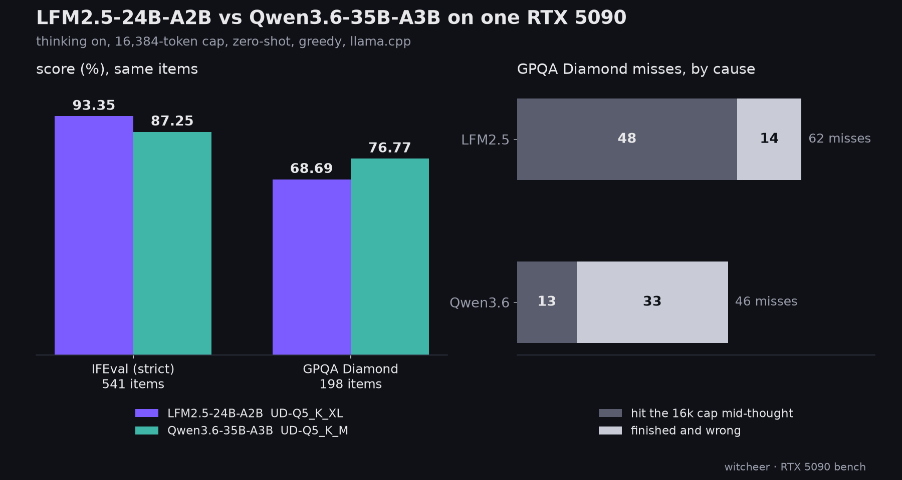

# LFM2.5-24B-A2B against Qwen3.6-35B-A3B: checking the model card's two claims on one RTX 5090

**The one line:** Liquid's model card says LFM2.5-24B-A2B beats Qwen3.6-35B-A3B on IFEval and trails it on GPQA Diamond. On the same items, thinking on, a 16k budget and 5-bit GGUFs, both directions hold: IFEval 93.35 vs 87.25, GPQA Diamond 68.69 vs 76.77. Most of the GPQA gap is the budget: 48 of LFM's 62 GPQA misses reached the 16,384-token cap mid-thought, against 13 of Qwen's 46.

**Rig:** RTX 5090 32GB (capsule), llama-server, batch 1 · **Window:** 2026-10-14 to 2026-10-15, inside the box's cheap-electricity hours (idle-queue item `65t-lfm25-24b`) · **Harness:** [llm-bench-rig](https://github.com/notwitcheer/llm-bench-rig) · **Status:** partial. IFEval (both LFM files) and GPQA Diamond (5-bit file) are finished; MATH-500, HumanEval+ and MBPP+ on both files and the 8-bit GPQA leg are still queued. This report covers only the finished legs, which are the two tasks the card names against Qwen3.6-35B-A3B.

## TL;DR

1. **IFEval: the card's direction holds, by more.** LFM2.5-24B-A2B UD-Q5_K_XL 93.35 (505/541, prompt-strict) vs Qwen3.6-35B-A3B UD-Q5_K_M 87.25 (472/541). Paired on items: LFM right where Qwen is wrong 39 times, the reverse 6 times (exact two-sided binomial p < 0.0001). LFM also thinks shorter here: median 1,660 completion tokens vs 2,375.
2. **GPQA Diamond: the card's direction holds too.** 68.69 (136/198) vs 76.77 (152/198). Paired: Qwen-only right 29, LFM-only right 13 (p = 0.020).
3. **The GPQA gap is mostly the 16k budget.** LFM's median GPQA completion is 6,992 tokens vs 2,981 for Qwen. 48 of LFM's 62 misses reached the cap; finished-and-wrong answers are LFM 14, Qwen 33. The card's own evaluation used a 32,768-token cap. A 32k GPQA leg on both rows has not been run.
4. **Quant tier barely moves IFEval.** The 8-bit LFM file scores 92.61 (501/541), 0.74 under the 5-bit file.
5. **Decode speed.** llama-bench tg128 on this card: LFM UD-Q5_K_XL 444.0 tok/s (b10371, 2026-10-14) vs the board's Qwen3.6-35B-A3B UD-Q4_K_M 270.97 tok/s and UD-Q6_K 259.65 tok/s (older build, 2026-05-28, `dataset/benchmarks.csv`). Served decode during the LFM eval: 378 tok/s, single stream.

## Setup

- **Regime, every row:** thinking on, `max_tokens 16384`, `ctx 24576`, greedy (`temperature 0`), zero-shot, batch 1 through llama-server's chat-completions endpoint.
- **Tasks:** IFEval (541 prompts, prompt-strict; `language:response_language` is skipped as unsupported, same for both rows), GPQA Diamond (198 questions, shuffle seed 42).
- **Subject:** [LiquidAI/LFM2.5-24B-A2B](https://huggingface.co/LiquidAI/LFM2.5-24B-A2B) as GGUF, UD-Q5_K_XL and Q8_0 ([unsloth/LFM2.5-24B-A2B-GGUF](https://huggingface.co/unsloth/LFM2.5-24B-A2B-GGUF)). Licence: Liquid's own `lfm1.0`, not Apache.
- **Comparison row (already on the second-tier 16k board, not re-run):** Qwen3.6-35B-A3B UD-Q5_K_M, 26,456,194,016 bytes, `dataset/second_tier.csv`.
- **Server binary:** the LFM legs ran on the rig's mainline llama-server, b10371 (`5d16e81dd`). The Qwen row predates per-row build logging, so the same build is not claimed.
- **Paired comparisons:** per-item `correct` and `capped` flags from each task's `*_tokens.jsonl`, joined on item index; exact two-sided binomial on the discordant items.

## The two claims

| Task | LFM2.5-24B-A2B UD-Q5_K_XL | Qwen3.6-35B-A3B UD-Q5_K_M | Card: LFM | Card: Qwen | Paired (LFM-only / Qwen-only) |
|---|---|---|---|---|---|
| IFEval | 93.35 (505/541) | 87.25 (472/541) | 96.75 | 93.06 | 39 / 6, p < 0.0001 |
| GPQA Diamond | 68.69 (136/198) | 76.77 (152/198) | 74.42 | 83.69 | 13 / 29, p = 0.020 |

The card's numbers come from vLLM at temperature 0.6 with a 32,768-token cap ("Other evals" in the card's evaluation settings), so both models score higher there; this board is greedy, 16k, 5-bit GGUF.

## Where the misses come from

| Task | Row | Misses | Capped misses | Finished and wrong | Median completion tokens |
|---|---|---|---|---|---|
| IFEval | LFM Q5 | 36 | 0 | 36 | 1,660 |
| IFEval | Qwen Q5 | 69 | 17 | 52 | 2,375 |
| GPQA Diamond | LFM Q5 | 62 | 48 | 14 | 6,992 |
| GPQA Diamond | Qwen Q5 | 46 | 13 | 33 | 2,981 |

## Limits

- One pass per item, greedy; GPQA's 198 items put one item at ~0.5 points.
- The finished-and-wrong count says LFM's GPQA losses are mostly budget, not that a bigger budget would turn them into right answers. That needs the 32k leg.
- Tool calling is not tested. The card says the model was trained with agentic RL inside agent harnesses (OpenClaw, Hermes Agent, Pi, OpenCode). On llama.cpp, [ggml-org/llama.cpp#30490](https://github.com/ggml-org/llama.cpp/issues/30490) (open at writing) reports its tool calls arriving as plain-text XML and being lost, so check tool-call parsing before agent use.
- The speed comparison crosses builds and quant tiers (LFM 5-bit on b10371 vs Qwen 4-bit and 6-bit on a May build).

## Sources

- capsule `~/benchmark-rig/results/lfm2-5-24b-a2b-ud-q5-k-xl-thinkon/{ifeval_detail.json,gpqa.json,ifeval_tokens.jsonl,gpqa_tokens.jsonl}`, `lfm2-5-24b-a2b-q8-0-thinkon/ifeval_detail.json`, `qwen3-6-35b-a3b-ud-q5-k-m-thinkon/{ifeval_detail.json,gpqa.json,*_tokens.jsonl}`, read 2026-10-15.
- Model card https://huggingface.co/LiquidAI/LFM2.5-24B-A2B, read 2026-10-15.
- Chart: `scripts/chart_lfm25_claims.py`.
