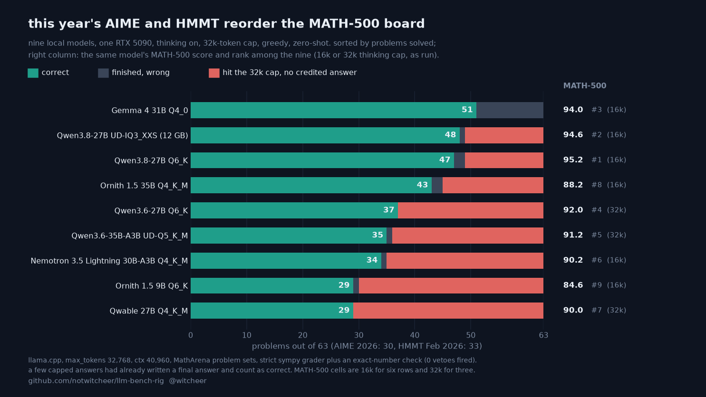

# This year's AIME and HMMT at a 32k thinking budget: nine local models against their MATH-500 order

**Rig:** RTX 5090 32GB (capsule), llama.cpp build 10371 (`5d16e81dd`), llama-server, batch 1 · **Window:** 2026-10-02 to 2026-10-06, inside the box's cheap-electricity hours · **Harness:** [llm-bench-rig](https://github.com/notwitcheer/llm-bench-rig), `lib/evals/matharena.py`, idle-queue items `57-matharena-contest`, `58-matharena-contest-ext`, `59-matharena-contest-ext2`, artefacts in `results/<slug>-matharena-32k/` · **Data:** [`dataset/matharena_contest_32k.csv`](../dataset/matharena_contest_32k.csv) · **Chart:** [`matharena-contests-32k.png`](matharena-contests-32k.png) · **Related:** [thinking on at a 16k budget](second-tier-thinkon-16k.md), [thinking on at a 32k budget](second-tier-thinkon-32k.md), [GPQA Diamond at a 32k budget](gpqa-thinkon-32k.md)

MATH-500 is the maths task on the second-tier board. It is old, public and close to saturated: for the nine models here it spans 84.6 to 95.2, and six of them sit between 90.2 and 95.2. This pass gives the same nine models the 63 problems of two 2026 competitions, AIME 2026 (30) and HMMT February 2026 (33), from MathArena's published sets, with thinking on and a 32,768-token completion budget.

Both contests took place in February 2026, before every model on this board was released (Hub dates: the sets 2026-02-13 and 2026-02-19, the earliest model, Gemma 4 31B, 2026-03-11). They are this year's problems, not problems the models could not have seen.

## TL;DR

1. **Gemma 4 31B solved the most, 51 of 63.** It was third of the nine on MATH-500 (94.0, behind Qwen3.8-27B Q6_K 95.2 and UD-IQ3_XXS 94.6). The two Qwen3.8-27B files follow at 48 (UD-IQ3_XXS) and 47 (Q6_K).
2. **The 32k cap is the mechanism.** Gemma's median completion was 8,259.5 tokens on AIME and 8,963 on HMMT, and none of its 63 answers hit the cap. The other eight hit it on 6 to 22 problems per contest. On the answers they did finish, those eight are right 95.5 to 100% of the time; Gemma is right on 51 of 63 (81.0%), but it finishes all of them.
3. **The lead over the Qwen3.8 rows is not significant on 63 problems.** Paired per problem, Gemma solved 5 that UD-IQ3_XXS missed and missed 2 it solved (exact McNemar p = 0.45), and 7 against 3 for Q6_K (p = 0.34). Against Ornith 1.5 35B it is 10 against 2 (p = 0.04).

## Setup

- **Regime:** thinking on, `max_tokens 32768`, `ctx 40960`, greedy, zero-shot, batch 1 through llama-server's chat-completions endpoint, one pass per problem. Every detail json carries `regime` `think-on, max_tokens 32768, ctx 40960, zero-shot, greedy`.
- **Sets:** `MathArena/aime_2026` (30) and `MathArena/hmmt_feb_2026` (33), final-answer problems.
- **Prompt and grading:** the same prompt and `\boxed{}` extraction as MATH-500, graded with the vendored Qwen2.5-Math grader (sympy) plus normalised string equality, in a forked child with a 20 s limit. MathArena grades with an LLM judge; ours is strict.
- **Exact-number veto:** on MathArena's published HMMT Feb 2026 outputs, the grader's numeric tolerance credited 46 answers that MathArena marks wrong (6 distinct answers on 2 problems, for example a large integer close to `3^{2025}`). The veto rejects a match when both sides parse to exact numbers with a provably non-zero difference. With it, agreement with MathArena's labels is 99.6% on HMMT (0 false positives, was 46) and 99.7% on AIME (unchanged, no veto fired there). In this pass it fired 0 times on all 18 legs. Scripts: `scripts/matharena_grader_agreement.py`, `scripts/matharena_exact_veto_test.py`.
- **Rows:** the nine GGUF files from the second-tier board whose think-on MATH-500 cell capped under about 12% (Qwopus3.8-27B-Flash is left out: its MATH-500 cell is a formatting result, 325 of 500 answers unboxed). The MATH-500 column is that board's cell as run: 16k for six rows, the 32k pass for the three rows that capped at 16k.

## The table

| Model | Quant | GGUF | AIME 2026 | HMMT Feb 2026 | Solved /63 | Capped /63 | Finished right | MATH-500 (budget) |
|---|---|---:|---:|---:|---:|---:|---:|---:|
| Gemma 4 31B-it | QAT Q4_0 | 17.7 GB | 25 | 26 | **51** | 0 | 51/63 (81.0%) | 94.0 (16k) |
| Qwen3.8-27B | UD-IQ3_XXS | 11.9 GB | 26 | 22 | **48** | 18 | 44/45 (97.8%) | 94.6 (16k) |
| Qwen3.8-27B | Q6_K | 22.9 GB | 25 | 22 | **47** | 19 | 42/44 (95.5%) | 95.2 (16k) |
| Ornith 1.5 35B-A3B | Q4_K_M | 21.7 GB | 23 | 20 | **43** | 19 | 42/44 (95.5%) | 88.2 (16k) |
| Qwen3.6-27B | Q6_K | 22.9 GB | 22 | 15 | **37** | 26 | 37/37 (100%) | 92.0 (32k) |
| Qwen3.6-35B-A3B | UD-Q5_K_M | 26.5 GB | 20 | 15 | **35** | 27 | 35/36 (97.2%) | 91.2 (32k) |
| Nemotron-3.5-Lightning 30B-A3B | Q4_K_M | 24.5 GB | 19 | 15 | **34** | 28 | 34/35 (97.1%) | 90.2 (16k) |
| Ornith 1.5 9B | Q6_K | 7.4 GB | 18 | 11 | **29** | 36 | 26/27 (96.3%) | 84.6 (16k) |
| Qwable-27B | Q4_K_M | 16.5 GB | 16 | 13 | **29** | 34 | 29/29 (100%) | 90.0 (32k) |

`Capped` is answers whose completion reached the 32k budget. `Finished right` is correct answers among the ones that ended inside the budget. Per-leg `correct`/`total`, `capped_count`, `capped_correct`, `parse_failures`, `exact_vetoes`, `tokens_per_correct` and the median completion length: [`dataset/matharena_contest_32k.csv`](../dataset/matharena_contest_32k.csv).

Wilson 95% intervals on 63 problems are wide: 51 is 69.6 to 88.8%, 47 is 62.7 to 83.7%. Read the top three as one group.

## Reads

1. **On these contests the budget decides the order.** Capped answers are 207 of the 504 non-Gemma answers. When a model does finish, it is almost always right, so the score mostly counts how many chains ended inside 32k.
2. **A capped answer rarely scores.** The grader can still credit a final answer written before the cut; 13 of the 207 capped answers were credited (4 for UD-IQ3_XXS, 5 for Q6_K, 1 for Ornith 1.5 35B, 3 for Ornith 1.5 9B, 0 for the rest).
3. **HMMT is where the chains run long.** The median HMMT completion is the full 32,768 tokens for five of the nine rows (Qwen3.6-27B, Qwen3.6-35B-A3B, Nemotron 3.5 Lightning, Ornith 1.5 9B, Qwable-27B). Gemma's HMMT median is 8,963.
4. **The 3-bit Qwen3.8-27B file scores level with the 6-bit one.** UD-IQ3_XXS (11.9 GB) solved 48 against 47 for Q6_K (22.9 GB), with the same cap count on HMMT (12) and one fewer on AIME (6 against 7). One problem apart is inside the noise.
5. **A low MATH-500 cap did not predict a low contest cap.** Qwen3.6-27B capped on 7.8% of MATH-500 at 32k and on 26 of 63 contest problems at the same budget.

## Worth it if / not if

- **Worth it if** you want a local model for competition-style maths with thinking capped at 32k: Gemma 4 31B QAT Q4_0 finished every problem here and solved the most. The 3-bit Qwen3.8-27B file is the smaller option at 48 of 63.
- **Not if** you can give the model a larger budget. Every non-Gemma row lost most of its misses to the cap, and this pass did not measure what they score with more room.

## Limits

- One greedy pass per problem, one card, 63 problems. The intervals above are sampling intervals, not run-to-run variance.
- The MATH-500 column mixes budgets (16k for six rows, 32k for three). All six 16k cells capped at 6.2% or less there, so the gap is small, but the columns are context, not a merged ranking.
- No budget above 32k on these contests. A 64k probe ran on ArXivMath 08/26 (research-level questions published after every release) for Qwen3.6-35B-A3B only: 1 of 57 right at 64k, 0 of 57 at 32k. That set is a limit check, not part of this table.
- A leg cut by a block's hard stop re-ran from its per-problem progress file at the next block, or from the start of the leg when no detail file had been written. Every final detail json matches its progress json (`correct` and `total` asserted by `scripts/contest_board_data.py`).

*Sources: `results/<slug>-matharena-32k/{ma_aime_2026,ma_hmmt_feb_2026}_{detail,progress}.json` and `_tokens.jsonl` on the rig, rebuilt 2026-10-07 with `scripts/contest_board_data.py` (identical to the 2026-10-06 build); MATH-500 cells from `results/<slug>-thinkon[-32k]/math500_detail.json` (same files as the second-tier boards); release dates from the Hub `createdAt` of each base repo; paired tests from the per-problem progress files; chart script `scripts/chart_contest_board.py`.*

## Addendum 2026-10-20: Ternary-Bonsai-2-27B, both packings

The two [Ternary-Bonsai-2-27B](https://huggingface.co/prism-ml/Ternary-Bonsai-2-27B-gguf) files from the [sub-10 GB Qwen3.8-27B study](sub10-qwen38-27b.md) ran the same 63 problems under the same regime (thinking on, `max_tokens 32768`, `ctx 40960`, greedy, exact-number veto on). One condition differs from the nine rows above: the server binary is the PrismML llama.cpp fork (`prism` branch, `4fbda12`, CUDA 12.8, sm_120), recorded in each detail json's `server_bin`, because the PTQ1_0 and PQ2_0 kernels are not in mainline. Run window 2026-10-11 to 2026-10-20 (idle-queue item `66-bonsai2-phase2`; the last leg, PQ2_0 HMMT, finished 2026-10-20 02:36 CEST). The chart at the top is the nine-row card as published and is left unchanged.

| Model | Quant | GGUF | AIME 2026 | HMMT Feb 2026 | Solved /63 | Capped /63 | Finished right | MATH-500 (budget) |
|---|---|---:|---:|---:|---:|---:|---:|---:|
| Qwen3.8-27B (from the table above) | UD-IQ3_XXS | 11.9 GB | 26 | 22 | **48** | 18 | 44/45 (97.8%) | 94.6 (16k) |
| Qwen3.8-27B (from the table above) | Q6_K | 22.9 GB | 25 | 22 | **47** | 19 | 42/44 (95.5%) | 95.2 (16k) |
| Ternary-Bonsai-2-27B † | PQ2_0 | 7.2 GB | 24 | 22 | **46** | 20 | 42/43 (97.7%) | 95.0 (16k) |
| Ternary-Bonsai-2-27B † | PTQ1_0 | 5.9 GB | 23 | 20 | **43** | 20 | 40/43 (93.0%) | 93.8 (16k) |

† PrismML llama.cpp fork `4fbda12`. File sizes 7,206,168,928 and 5,946,648,928 bytes (`stat -L`). Per-leg counts, parse failures, tokens per correct answer and median completion: the four `ternary-bonsai-2-27b-*` rows of [`dataset/matharena_contest_32k.csv`](../dataset/matharena_contest_32k.csv).

Paired per problem on the same 63 (exact McNemar, two-sided; first number = the Bonsai file right and the other row wrong):

| Bonsai file | vs Q6_K | vs UD-IQ3_XXS | vs Gemma 4 31B | vs Ornith 1.5 35B |
|---|---:|---:|---:|---:|
| PQ2_0 | 6 / 7 (p = 1.0) | 3 / 5 (p = 0.73) | 2 / 7 (p = 0.18) | 7 / 4 (p = 0.55) |
| PTQ1_0 | 2 / 6 (p = 0.29) | 1 / 6 (p = 0.13) | 2 / 10 (p = 0.04) | 6 / 6 (p = 1.0) |

### Reads (addendum)

1. **The 7.2 GB PQ2_0 file sits level with the 22.9 GB Q6_K file on this year's contests:** 46 against 47 solved, 6 against 7 discordant problems. Wilson 95% intervals on 63 problems: 46 is 61.0 to 82.4%, 47 is 62.7 to 83.7%.
2. **The same mechanism as the rest of this page.** Both Bonsai files capped on 20 of 63 problems, against 19 for Q6_K and 18 for UD-IQ3_XXS; 13 of PQ2_0's 20 capped problems are also capped for Q6_K. Of the answers that finished inside 32k, PQ2_0 is right on 42 of 43. The grader credited 4 of PQ2_0's capped answers and 3 of PTQ1_0's (a final answer written before the cut).
3. **PTQ1_0 (5.9 GB) is three problems behind PQ2_0** (5 / 2 discordant, p = 0.45), not a significant gap on 63 problems. Against Gemma 4 31B it is the only Bonsai comparison under p = 0.05 (2 / 10).

### Limits (addendum)

- Different server binary from the nine rows above (PrismML fork against mainline b10371); harness, prompt, grader, veto and regime are identical. Zero request errors and zero vetoes on all four legs.
- One greedy pass per problem, 63 problems, the same limits as the rest of this page. The model card recommends a longer output budget (`-n 16384` or more with `-c 65536`); 32k is this page's budget for every row, not a Bonsai-specific choice.

*Sources (addendum): `results/ternary-bonsai-2-27b-{pq2-0,ptq1-0}-matharena-32k/{ma_aime_2026,ma_hmmt_feb_2026}_{detail,progress}.json` on the rig, read 2026-10-20 ~07:30 CEST; MATH-500 cells from `results/ternary-bonsai-2-27b-*-thinkon/math500_detail.json`; paired tests from the per-problem progress files.*

## Addendum 2026-10-25: Underdog-Saluki-27B and Qwen3.8-27B GSQ-RCO IQ2_XS

The two other small files of the [sub-10 GB study](sub10-qwen38-27b.md) ran the same 63 problems under the same regime (thinking on, `max_tokens 32768`, `ctx 40960`, greedy, exact-number veto on; 0 vetoes fired). Same mainline llama.cpp b10371 (`5d16e81dd`) as the nine rows above; the legs finished 2026-10-25 (idle-queue item `67-sub10-qwen38-27b`). The chart at the top is the nine-row card as published and is left unchanged.

| Model | Quant | GGUF | AIME 2026 | HMMT Feb 2026 | Solved /63 | Capped /63 | Finished right | MATH-500 (budget) |
|---|---|---:|---:|---:|---:|---:|---:|---:|
| Qwen3.8-27B (from the table above) | UD-IQ3_XXS | 11.9 GB | 26 | 22 | **48** | 18 | 44/45 (97.8%) | 94.6 (16k) |
| Qwen3.8-27B (from the table above) | Q6_K | 22.9 GB | 25 | 22 | **47** | 19 | 42/44 (95.5%) | 95.2 (16k) |
| Qwen3.8-27B GSQ-RCO | IQ2_XS | 8.4 GB | 23 | 19 | **42** | 21 | 37/42 (88.1%) | 92.8 (16k) |
| Underdog-Saluki-27B-1.0 | IQ2-mix | 7.9 GB | 23 | 16 | **39** | 26 | 35/37 (94.6%) | 91.6 (16k) |

Per-leg counts, parse failures, tokens per correct answer and median completion: the four new rows of [`dataset/matharena_contest_32k.csv`](../dataset/matharena_contest_32k.csv) (file sizes 8,422,841,472 and 7,898,369,152 bytes, `stat -L`).

Paired per problem on the same 63 (exact McNemar, two-sided; first number = the first-named row right and the other wrong):

| Pair | AIME (30) | HMMT (33) | Both (63) |
|---|---:|---:|---:|
| GSQ-RCO vs Saluki | 2 / 2 | 5 / 2 | 7 / 4 (p = 0.55) |
| Q6_K vs GSQ-RCO | 2 / 0 | 5 / 2 | 7 / 2 (p = 0.18) |
| Q6_K vs Saluki | 3 / 1 | 8 / 2 | 11 / 3 (p = 0.057) |
| UD-IQ3_XXS vs GSQ-RCO | 4 / 1 | 5 / 2 | 9 / 3 (p = 0.15) |
| UD-IQ3_XXS vs Saluki | 4 / 1 | 7 / 1 | 11 / 2 (p = 0.023) |

### Reads (2026-10-25)

1. **GSQ-RCO is level with Saluki on AIME (23 of 30 each, 2 / 2 discordant) and ahead on HMMT (19 against 16; 5 / 2, p = 0.45).** Neither gap is significant on 63 problems.
2. **HMMT is a token-budget floor for both small files.** Saluki capped on 18 of 33 problems (54.5%, median completion 32,768 tokens) and is right on all 15 it finished; GSQ-RCO capped on 14 (43.8% by the harness over the 32 problems with a recorded completion, 42.4% of 33) against 12 for Q6_K and UD-IQ3_XXS. Read the HMMT column as how many chains ended inside 32k, not as the file's maths ceiling. AIME caps on 20% to 27% for every row, comparison rows included.
3. **Saluki's model card lists AIME 2026 avg@4 80.0; this single greedy pass solved 23 of 30 (76.67).** 80.0% of 30 is 24 problems: one problem apart, inside the noise of a 30-problem set and a different harness. Not a contradiction.

### Limits (2026-10-25)

- One of GSQ-RCO's HMMT problems returned an HTTP 500 (context size exceeded), was scored wrong and counts as finished (1 request error in the detail json; zero on the other three legs).
- One greedy pass per problem, 63 problems; the other limits of this page apply. The sub-10 GB report's [2026-10-25 addendum](sub10-qwen38-27b.md#addendum-2026-10-25-gpqa-diamond-and-this-years-contests-for-saluki-and-gsq-rco) carries the GPQA Diamond cells and the cap-split reads.

*Sources (addendum): `results/{underdog-saluki-27b-iq2-mix,qwen3-8-27b-gsq-rco-iq2-xs}-matharena-32k/{ma_aime_2026,ma_hmmt_feb_2026}_{detail,progress}.json` on the rig, read 2026-10-25; MATH-500 cells from `results/*-thinkon/math500_detail.json`; paired tests and cap splits from [`scripts/sub10_addendum_1025.py`](../scripts/sub10_addendum_1025.py); model card [ConwayResearch/Underdog-Saluki-27B-1.0](https://huggingface.co/ConwayResearch/Underdog-Saluki-27B-1.0), read 2026-10-25.*
