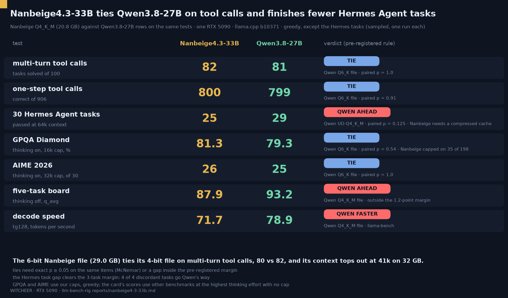

# Nanbeige4.3-33B against Qwen3.8-27B on one RTX 5090: Hermes Agent tool calls, 30 Hermes tasks, speed and the context ceiling

**The one line:** Nanbeige4.3-33B (Q4_K_M, 20.8 GB) ties Qwen3.8-27B Q6_K on multi-turn tool calls (82 vs 81 of 100, exact p = 1.0) and on one-step tool calls (800 vs 799 of 906), but finishes 25 of 30 real Hermes Agent tasks to Qwen UD-Q4_K_M's 29, scores 87.88 against 93.17 on the five-task board with thinking off, and decodes about 10% slower. Its 6-bit file (29.0 GB) ties its own 4-bit file on multi-turn tool calls (80 vs 82, p = 0.77) and stops at 40,960 tokens of context on 32 GB.

**Rig:** RTX 5090 32GB (capsule), llama.cpp, batch 1 · **Window:** 2026-11-01 02:48 CET to 2026-11-02 (idle-queue item `77-nanbeige43-33b-fullpass`, cheap-electricity hours; the Q6_K GPQA and AIME legs were cut by the Sunday 23:59 hard stop and resumed 2026-11-02 02:39 CET; readout `nb_readout.py` 2026-11-02 06:08 CET) · **Harness:** [llm-bench-rig](https://github.com/notwitcheer/llm-bench-rig): [`toolcall/`](../toolcall/README.md), [`agenttest/v2/`](../agenttest/v2/), second-tier lane; queue item and helpers in [`scripts/capsule-queue/`](../scripts/capsule-queue/) · **Chart:** [`nanbeige4-3-33b.png`](nanbeige4-3-33b.png) ([`scripts/chart_nanbeige43.py`](../scripts/chart_nanbeige43.py))

Status of this page: every number below comes from `nb_readout.py` run 2026-11-02 06:08 CET. **Q6_K AIME 2026, added 2026-11-02 after the leg finished (15:57 CET, readout rerun): 86.67 (26 / 30), capped 0.1333, against Qwen3.8-27B Q6_K 83.33 (25 / 30), discordant 2 / 1, p = 1.0, a tie.**

## TL;DR

1. **Tool calls: a tie, on both tests.** Multi-turn (BFCL v4 `multi_turn_base`, 100 entries, thinking on): Nanbeige Q4_K_M 82, Qwen3.8-27B Q6_K 81, discordant 9 / 8, exact p = 1.0. One-step (906 scored items, set-weighted): 800 vs 799; on the 899 unique requests 796 vs 794, discordant 40 / 38, p = 0.9099 (+0.2 points, inside the pre-registered 2.5-point margin). The 6-bit Nanbeige file also ties Qwen Q6_K: 80 vs 81 multi-turn (7 / 8, p = 1.0), 793 vs 794 on 899 ids one-step (42 / 43, p = 1.0).
2. **Real Hermes Agent tasks: Qwen finishes more.** Agenttest v2 (30 frozen tasks, real Hermes Agent sessions, 64k context, card sampling): Nanbeige Q4_K_M 25 of 30, Qwen UD-Q4_K_M 29, Qwen Q6_K 30. All 4 discordant tasks against UD-Q4_K_M go Qwen's way (0 / 4, p = 0.125); the lead of 4 is over the 3-task margin from the agenttest v2 pre-registration, so it is called a Qwen lead, with the p-value beside it. Nanbeige runs this row with a compressed (q8_0) KV cache because its f16 cache does not fit 64k; Qwen ran f16.
3. **Which file: the 6-bit buys nothing on tool calls and loses context.** Q4_K_M 82 vs Q6_K 80 of 100 multi-turn, discordant 7 / 5, p = 0.7744: a tie. Context ceiling on 32 GB: Q4_K_M 59,392 tokens (f16 KV) or 106,496 (q8_0 KV); Q6_K 22,528 (f16) or 40,960 (q8_0). The Q6_K cannot run the 64k Hermes Agent task set in either cache type.
4. **Maths and science with thinking on: a tie on our budget.** GPQA Diamond 81.31 (161 of 198) vs Qwen Q6_K 79.29 (157), discordant 14 / 10, p = 0.5413; AIME 2026 at a 32k budget 26 vs 25 of 30, discordant 2 / 1, p = 1.0. Nanbeige hit the 16,384-token GPQA cap on 35 of 198 questions (capped rate 0.1768) and Qwen on none, so its GPQA number is a floor.
5. **Board and speed: Qwen ahead.** Five-task board with thinking off (q_avg of MMLU, ARC, HellaSwag, HumanEval, GSM8K): Nanbeige 87.88 vs Qwen Q4_K_M 93.17 (delta -5.29, outside the 1.2-point margin). llama-bench tg128: 71.73 vs 78.94 tok/s at Q4_K_M, 53.93 vs 63.08 at Q6_K.
6. **Serving flag.** The GGUF's tokenizer metadata makes stock llama.cpp insert an extra space token after every special token: 1,998 of 1,998 frozen prompts differ from the official tokenizer, 0 with `--override-kv tokenizer.ggml.add_space_prefix=bool:false`. Details [below](#the-tokenizer-space-prefix-finding). Every row on this page ran with the flag.

## Setup

- **Subject:** [Nanbeige/Nanbeige4.3-33B](https://huggingface.co/Nanbeige/Nanbeige4.3-33B) (created 2026-10-24, Apache-2.0, dense LlamaForCausalLM, 52 layers, hidden 7168, 56 attention heads / 8 KV heads, head_dim 128, vocab 166,912; repo sha `df919e1e2cf077a22204c78b6c826bf3db18bc08`, card read 2026-10-30 ~13:50 CET). GGUFs from [bartowski/Nanbeige_Nanbeige4.3-33B-GGUF](https://huggingface.co/bartowski/Nanbeige_Nanbeige4.3-33B-GGUF) at repo sha `9beb68421fdf7be095093a6888325fa2c83ddd38`:

| File | Bytes | sha256 |
|---|---:|---|
| `Nanbeige_Nanbeige4.3-33B-Q4_K_M.gguf` | 20,788,825,216 | `2cef79855ca47ee6571e166db32a07089e34f3cf78e0397b262d124ddb814c37` |
| `Nanbeige_Nanbeige4.3-33B-Q6_K.gguf` | 29,016,857,728 | `b11c9f21e69d896a1c20b12f88174f069e0e15623140733a49ff8e47c5541fbc` |

- **Comparator: Qwen3.8-27B rows already on this board, not re-run.** Pre-registered before any Nanbeige output existed: toolcall-v1, GPQA and AIME against Qwen3.8-27B Q6_K (no Q4_K_M-class row exists on those harnesses, so a smaller Nanbeige file meets the champion's best file, the stricter test for Nanbeige); agenttest v2 against the Unsloth UD-Q4_K_M row (the Q4_K_M-class row, 29 of 30) with the Q6_K row (30 of 30) beside it; board and speed against Qwen's Q4_K_M and Q6_K rows of the same quant.
- **Server:** mainline llama.cpp b10371 (`5d16e81dd`) for the board, speed, fit, toolcall, GPQA and AIME legs; the agenttest v2 item uses its own build (`0.6.0-dev`, build 11668, commit `cd0a5b6a1`). `llama-server --jinja` on the agenttest build parses the model's XML tool calls into structured `tool_calls` (CPU probe, thinking off).
- **Chat template:** the template embedded in the Q4_K_M GGUF is byte-identical to the HF `tokenizer_config.json` template (8,003 chars, sha256 `f2b1e2a1be25d277e8c903a2aa4d69ca5fd8a0fcb37d4792088e72426df5b91c`); the DRYRUN asserted the same hash on the Q6_K. Tool grammar is the Qwen3.8 one (`<tool_call><function=NAME><parameter=K>...`), so the unchanged `toolcall-v1-parser-2` carries over: 799 of 799 ground-truth call sets round-trip losslessly through the Nanbeige template ([`toolcall/artifacts/nanbeige-roundtrip.json`](../toolcall/artifacts/nanbeige-roundtrip.json)). The Nanbeige template inserts a Chinese default system prompt when tools are passed with no system message; both it and its different `# Tools` preamble go to the model as written.
- **Raw-mode driver change:** the GGUF has `add_bos_token = true` with BOS = `<|im_start|>`, so a raw text prompt that already starts with the template's `<|im_start|>` gets a second one. toolcall-v1 therefore sends token-id arrays encoded client-side with the pinned HF tokenizer (`--prompt-tokens`, default off, so the Qwen rows are untouched; see [`toolcall/driver.py`](../toolcall/driver.py)).
- **Regimes (same as the Qwen comparators):** toolcall-v1 `st-on` is S1 to S4 with thinking on, `max_tokens 16384`, ctx 24,576; `s5-on` is S5 with thinking on, ctx 40,960; greedy, one run per leg, `preserve_thinking` left at its default (undefined = keep, as in the Qwen rows). GPQA Diamond: thinking on, 16,384-token budget, greedy, 198 questions (second tier, never folded into the board). AIME 2026: thinking on, 32,768-token budget, greedy, 30 problems, exact-number veto. Board: five tasks, sample 0.5, thinking off, greedy. Agenttest v2: 30 frozen tasks, real Hermes Agent sessions, `-c 65536`, the card's agentic sampling as explicit flags (temp 1.0, top_p 0.95, top_k off, min_p 0.05), one sampled run per row.
- **KV type per leg (labelled where it differs from the Qwen f16 rows):** Q4_K_M ran every leg at f16 KV except agenttest (q8_0). Q6_K ran board5 at f16 and the toolcall S1 to S4, S5, GPQA and AIME legs at q8_0 KV (its f16 ceiling, 22,528, is below the 24,576 / 40,960 those legs plan). Accuracy with q8_0 KV is only measured by those rows; the hermes-settings study found q8_0 moving Qwen3.8-27B Q6_K multi-turn by at most 3 of 100 (a Qwen fact, not assumed for Nanbeige).
- **Paired tests:** exact two-sided McNemar on the discordant items between the two models themselves (never each against a reference), computed in [`scripts/capsule-queue/nb_readout.py`](../scripts/capsule-queue/nb_readout.py) from per-item outcomes: single-turn on the 899 unique ids, multi-turn S5 on 100, agenttest on 30 tasks, GPQA on 198, AIME on 30, plus Nanbeige Q4_K_M against Q6_K on S5. The board has no per-item pairing (aggregate plus tie margin).
- **Tie margins (pre-registered):** board q_avg +-1.2 points; toolcall single-turn +-2.5 points; S5 and every item-level test need exact p < 0.05 for a win or loss; GPQA +-3 points; AIME +-2 problems; agenttest a lead under 3 of 30 tasks is a tie.

## Context ceilings

KV cache per token is 208 KiB at f16 (52 layers x 8 KV heads x 128 x K and V x 2 bytes) and 110.5 KiB at q8_0, 3.2x Qwen3.8-27B's 65 KiB. Fit leg: one `llama-server` per point on the board build (`-ngl 99 -fa on --fit off`), about 6k tokens of prefill plus a short decode, a point counts only if the reply came back; the card is otherwise idle (no desktop or browser).

| File | Weights | f16 KV ceiling (first fail) | q8_0 KV ceiling (first fail) | VRAM loaded / peak at the f16 ceiling | 64k Hermes Agent |
|---|---:|---|---|---|---|
| Q4_K_M | 19.36 GiB | **59,392** (61,440) | **106,496** (110,592) | 32,048 / 32,072 MiB | f16 no; q8_0 yes |
| Q6_K | 27.02 GiB | **22,528** (23,552) | **40,960** (43,008) | 32,076 / 32,098 MiB | no, in either KV type |

A ceiling is what a loaded server can hold on an idle card. A separate fit run of the same Q4_K_M with a Chromium process alive measured 81,920 tokens at q8_0 with about 3.2 GiB free, and 98,304 with under the 1,536 MiB headroom that run requires; take 81,920 or less if a browser shares the card.

## The board

Scores: tool calls as correct of total; Hermes tasks as passed of 30; GPQA and AIME as percent (correct / total). Nanbeige is the Q4_K_M file unless the row says Q6_K.

| Test | Nanbeige Q4_K_M | Qwen3.8-27B comparator | Paired test | Verdict (pre-registered rule) |
|---|---|---|---|---|
| Multi-turn tool calls (S5, 100) | 82 | Q6_K 81 | discordant 9 / 8, p = 1.0 | tie |
| One-step tool calls (906) | 800 | Q6_K 799 | 796 vs 794 on 899 ids, discordant 40 / 38, p = 0.9099 | tie (+0.2 pts) |
| Hermes Agent tasks (30, 64k) | 25 (q8_0 KV) | UD-Q4_K_M 29 (f16); Q6_K 30 | 0 / 4, p = 0.125 (Q6_K: 0 / 5, p = 0.0625) | Qwen ahead by the 3-task clause |
| GPQA Diamond, thinking on, 16k | 81.31 (161 / 198), capped 0.1768 | Q6_K 79.29 (157 / 198), capped 0.0 | 14 / 10, p = 0.5413 | tie (+2.02 pts) |
| AIME 2026, thinking on, 32k | 86.67 (26 / 30), capped 0.2 | Q6_K 83.33 (25 / 30), capped 0.2333 | 2 / 1, p = 1.0 | tie |
| Five-task board q_avg, thinking off | 87.88 | Q4_K_M 93.17 | aggregate only | Qwen ahead (-5.29) |
| Decode tg128, tok/s | 71.73 | Q4_K_M 78.94 | none | Qwen 10% faster |

Nanbeige Q6_K against its Q6_K comparators: multi-turn 80 vs 81 (7 / 8, p = 1.0), one-step 797 / 906 set-weighted and 793 vs 794 on 899 ids (42 / 43, p = 1.0), GPQA 79.8 (158 / 198, capped 0.1869) vs Qwen Q6_K 79.29 (10 / 9 discordant, p = 1.0), board q_avg 88.32 vs 93.66 (delta -5.34), tg128 53.93 vs 63.08 tok/s, agenttest NOFIT in both KV types (ceilings below 65,536). Against the Qwen UD-IQ3_XXS row (815 / 906 one-step, 80 of 100 multi-turn) the Q6_K one-step pair is 793 vs 810 on 899 ids, 30 / 47 discordant, p = 0.0675, and multi-turn 80 vs 80.

### Five-task board, per task

| Row | MMLU | ARC | HellaSwag | HumanEval | GSM8K | q_avg |
|---|---:|---:|---:|---:|---:|---:|
| Nanbeige Q4_K_M | 81.47 | 93.86 | 81.28 | 90.24 | 92.57 | **87.88** |
| Qwen3.8-27B Q4_K_M | 85.01 | 96.76 | 94.30 | 92.68 | 97.12 | **93.17** |
| Nanbeige Q6_K | 81.93 | 94.20 | 81.60 | 90.85 | 93.03 | **88.32** |
| Qwen3.8-27B Q6_K | 85.28 | 96.67 | 94.34 | 94.51 | 97.50 | **93.66** |

### Speed (llama-bench, board build, f16 KV, batch 1)

| Row | tg128 | pp512 | tg128 at depth 8,192 | tg128 at depth 32,768 | VRAM peak |
|---|---:|---:|---:|---:|---:|
| Nanbeige Q4_K_M | 71.73 | 3,834.85 | 65.98 | 54.79 | 23,456 MiB |
| Qwen3.8-27B Q4_K_M | 78.94 | 3,881.34 | no row | no row | 17,674 MiB |
| Nanbeige Q6_K | 53.93 | 3,176.46 | 50.56 | no row | 31,006 MiB |
| Qwen3.8-27B Q6_K | 63.08 | 3,223.28 | 60.41 | 58.28 | 22,802 MiB |

llama-bench tg128 and server completion throughput are different measurements; the table is llama-bench. Agenttest v2 decode medians (server, real Hermes sessions) were 49.1 tok/s for Nanbeige Q4_K_M at q8_0 KV against 75.0 for Qwen UD-Q4_K_M and 60.0 for Qwen Q6_K.

### Agenttest v2, per row

| Row | Pass / 30 | A | B | C | Blocks | Other errors | Wall (min) | Peak MiB |
|---|---:|---:|---:|---:|---:|---:|---:|---:|
| Nanbeige Q4_K_M, f16 KV | NOFIT | | | | | | | not tried (ceiling 59,392 < 65,536) |
| Nanbeige Q4_K_M, q8_0 KV | **25** | 4/5 | 15/16 | 6/9 | 38 | 14 | 138 | 27,262 |
| Nanbeige Q6_K, f16 KV | NOFIT | | | | | | | not tried (ceiling 22,528) |
| Nanbeige Q6_K, q8_0 KV | NOFIT | | | | | | | not tried (ceiling 40,960) |
| Qwen3.8-27B UD-Q4_K_M | **29** | 5/5 | 15/16 | 9/9 | 22 | 11 | 29 | 23,121 |
| Qwen3.8-27B Q6_K | **30** | 5/5 | 16/16 | 9/9 | 18 | 18 | 43 | 26,034 |
| Qwen3.8-27B UD-IQ3_XXS | **28** | 4/5 | 15/16 | 9/9 | 22 | 7 | 29 | 16,322 |

Nanbeige Q4_K_M failed t06, t19, t23, t27 and t28 (t23 is also the one task Qwen UD-Q4_K_M failed). A NOFIT row is a measured result: a 64k Hermes Agent session does not fit that file and cache type on 32 GB. The rows are single sampled runs at temperature 1.0, so a repeat can move any of them; the Qwen Q6_K 30 of 30 may not repeat either.

**Clause note.** Two pre-registered clauses touch agenttest. The agenttest-specific one (a lead under 3 of 30 tasks is a tie, unchanged from the agenttest v2 pre-registration) makes the 4-task lead a Qwen lead. The general one (an item-level win or loss needs exact p < 0.05) would call it a tie: all 4 discordant tasks go Qwen's way, but p is 0.125 on n = 4. The more specific clause is applied and the p-value is reported beside it. The row also carries a confound: Nanbeige ran q8_0 KV, forced by its own ceiling, and Qwen ran f16.

## The tokenizer space-prefix finding

The Nanbeige4.3 GGUFs carry `tokenizer.ggml.add_space_prefix = true`. llama.cpp's SPM tokenizer then places a lone `▁` after every special token, so a ChatML prompt reaches the model as `<|im_start|>▁user` and `<|im_end|>▁\n` where the HF tokenizer, the one the model was trained with, gives `<|im_start|>user` and `<|im_end|>\n`.

- **Evidence:** the server's `/tokenize` differs from the HF token ids on 1,998 of 1,998 frozen toolcall-v1 prompts (for example 740 vs 735 tokens on `multiple_0`); the chat-completions path is affected too (52 prompt tokens stock against 48 with the fix on a two-line chat).
- **Fix:** start the server with `--override-kv tokenizer.ggml.add_space_prefix=bool:false`. With it, 0 of 1,998 prompts differ and the chat prompt token count matches. Verified on two llama.cpp builds (b10371 `5d16e81dd` and build 11668 `cd0a5b6a1`).
- **On this page:** every Nanbeige server in the queue item carries the flag, and a two-string guard refuses a leg when the server's tokens disagree with the HF ids. The toolcall legs additionally send token-id arrays encoded with the HF tokenizer.
- **What is not measured:** how much a stock-tokenizer server costs on tool calls. An optional comparison leg exists in the queue item and has not run.

## Reads

1. **On Hermes-style tool calls this model is level with the champion, at 21 GB instead of 23 GB.** Multi-turn 82 vs 81 and one-step 800 vs 799, neither paired test near significance. The 100-entry multi-turn test cannot separate two files within a handful of tasks (the Wilson interval on 100 tasks is about 15 points wide); the paired counts are the evidence, and they say tie.
2. **Where it loses is the long Hermes Agent session.** 25 of 30 against 29, all four discordant tasks Qwen's, on a row where Nanbeige was forced into a compressed KV cache to reach 64k at all, and where it also ran 138 minutes against Qwen's 29 (decode median 49.1 against 75.0 tok/s, and 38 blocked actions against 22). Which share of the gap is the cache type, the model or sampling noise is not separated by one run each.
3. **The 6-bit file is not the pick on a 32 GB card.** It ties the 4-bit file on multi-turn calls (80 vs 82), decodes 25% slower (53.93 vs 71.73 tok/s), cannot run the 64k task set in either cache type, and tops out at 40,960 tokens. The 4-bit file loads with 106k of context at q8_0.
4. **GPQA and AIME on our budget are a tie, and Nanbeige is under-measured at the cap.** On GPQA 35 of 198 Nanbeige questions reached the 16,384-token cap (0.1768) against none for Qwen Q6_K, so the 81.31 is a floor; on AIME the capped rates are 0.2 and 0.2333. This does not show what either model scores with an unlimited budget.
5. **The five-task board is where the gap is widest** (-5.29 at Q4_K_M, -5.34 at Q6_K): HellaSwag 81.28 vs 94.30 and MMLU 81.47 vs 85.01 carry it. These are thinking-off knowledge tasks, a different question from the tool-call tests.

## The model card's claims, checked where this regime can

The card's table (read 2026-10-30) compares Nanbeige4.3-33B with Qwen3.8-27B with every model at its highest thinking effort, Nanbeige with `preserve_thinking=true`, sampled, with no budget cap: Terminal-Bench 2.1 80.9 vs 73.0, DeepSWE 65.5 vs 42.5, SWE-Bench Pro 60.3 vs 61.7, Toolathlon-Verified 70.4 vs 68.5, Tau3 48.8 vs 48.5, GPQA Diamond 89.5 vs 89.2, AIME 2026 95.2 vs 94.5.

- **GPQA Diamond and AIME 2026:** the card has Nanbeige slightly ahead of Qwen (89.5 vs 89.2, 95.2 vs 94.5); ours are a tie with Nanbeige nominally ahead (81.31 vs 79.29, 26 vs 25 of 30). Our absolute scores are lower because they are greedy at a 16k (GPQA) and 32k (AIME) cap against the card's unlimited budget, so the gap to the card's numbers is a budget-and-sampling difference first.
- **Terminal-Bench 2.1, DeepSWE, SWE-Bench Pro, Toolathlon-Verified, Tau3:** not run here. Our tool-call tests are a BFCL v4 slice and 30 Hermes Agent tasks, not those harnesses; nothing here confirms or contradicts the card on them.
- Nothing on this page says the card is wrong. It says how the claim holds on Hermes-shaped work on one 32 GB card.

## Worth it if / not if

- **Worth it if** your main use is maths and science questions with thinking on, or you want a second model family for tool calls: it ties Qwen3.8-27B Q6_K there from a smaller file.
- **Not if** the job is long Hermes Agent sessions on a 32 GB card: Qwen3.8-27B finished more of the 30 tasks (29 and 30 vs 25), decodes faster and reaches 64k without compressing the cache.
- **Not if** you were going to buy room for the 6-bit file: it ties the 4-bit on multi-turn tool calls and stops at 40,960 tokens of context.
- **If you serve this GGUF with llama.cpp:** add the `--override-kv` flag above.

## Honest limits

- One greedy run per toolcall, GPQA, AIME and board leg, one card; agenttest rows are single sampled runs at temperature 1.0. The intervals are sampling intervals, not run-to-run variance.
- The comparators are the Qwen3.8-27B rows banked earlier, run on the same harnesses, not re-run alongside. The Qwen agenttest rows use a different quant family (Unsloth UD-Q4_K_M, f16 KV) from Nanbeige's Q4_K_M (q8_0 KV).
- The card's own scores use other benchmarks at the highest thinking effort, sampled, with an unlimited budget and `preserve_thinking=true`; ours are capped (GPQA 16k, AIME 32k) and greedy. Where a number sits beside the card's, a difference is a budget-and-sampling difference first.
- Q6_K runs the toolcall legs at q8_0 KV (its f16 ceiling is below the planned context); Q4_K_M runs agenttest at q8_0. Neither is measured against an f16 row of the same file.
- The ceilings are exact to the fit ladder's resolution on an idle card.
- Decode and VRAM numbers are llama-bench at batch 1; no concurrency or long-session throughput measurement beyond the agenttest decode median.
- The stock-tokenizer cost is not measured.
- Terminal-Bench 2.1, DeepSWE and the card's other agent benchmarks are not harnesses this rig runs.

## Owed

- Nanbeige Q6_K AIME 2026 at 32k: 26 of 30 (86.67), capped 0.1333, vs Qwen3.8-27B Q6_K 25 of 30, discordant 2 / 1, p = 1.0 (a tie); one greedy run, finished 2026-11-02 15:57 CET in the second cheap-electricity block.
- Optional: the stock-tokenizer comparison leg (no flag) on one-step tool calls.

*Sources: `results/nanbeige-nanbeige4-3-33b-q{4-k-m,6-k}{,-thinkon,-matharena-32k}/` (quality, speed, fit, gpqa, AIME detail), `results/toolcall-v1/nanbeige-nanbeige4-3-33b-q{4-k-m,6-k}-{st-on,s5-on}/` against `results/toolcall-v1/qwen3-8-27b-q6-k-{st-on,s5-on}/`, `agenttest-v2/results/nb43/nanbeige43-33b-q4km-{f16,q8kv}/` against `agenttest-v2/results/c1/qwen38-27b-{ud-q4km,q6k,ud-iq3xxs}/`, `results/qwen3-8-27b-{q4-k-m,q6-k}/{quality,speed}.json`, `results/qwen3-8-27b-q6-k-thinkon-rerun/gpqa.json`, `results/qwen3-8-27b-q6-k-matharena-32k/`, all read through [`scripts/capsule-queue/nb_readout.py`](../scripts/capsule-queue/nb_readout.py) on 2026-11-02 06:08 CET; queue item [`scripts/capsule-queue/77-nanbeige43-33b-fullpass.sh`](../scripts/capsule-queue/77-nanbeige43-33b-fullpass.sh) and its helpers `nb_fit.py`, `nb_speed.py`, `nb_cell.py`, `nb_plan.py`; agenttest row file [`agenttest/v2/rows-nanbeige.json`](../agenttest/v2/rows-nanbeige.json); toolcall artifacts [`toolcall/artifacts/nanbeige-*`](../toolcall/artifacts/); model card [Nanbeige/Nanbeige4.3-33B](https://huggingface.co/Nanbeige/Nanbeige4.3-33B), read 2026-10-30.*
