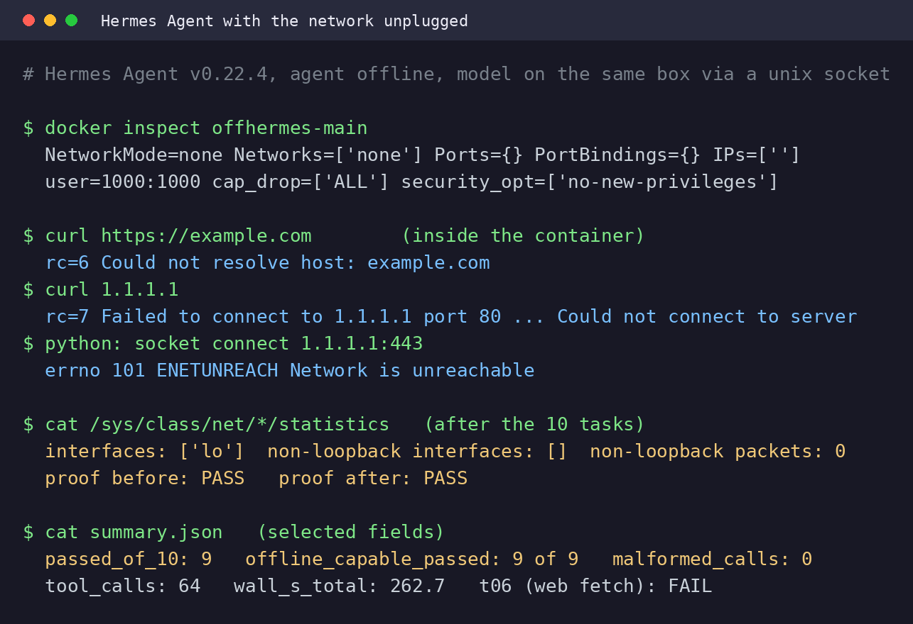

# Hermes Agent with the network unplugged: 9 of 10 everyday tasks, zero packets out

**The one line:** Hermes Agent v0.22.4 ran inside `docker run --network none` against Qwen3.8-27B UD-Q4_K_M and passed 9 of 10 everyday tasks (all 9 that can work offline), with 0 non-loopback packets counted inside the container before and after. The 10th task, fetching a web page, failed by a rule written before the run: the agent said it could not reach the page and did not make up its content.

**Rig:** RTX 5090 32GB (capsule), llama.cpp b11668 (`cd0a5b6a1`), batch 1 · **Window:** one run, 2026-11-01 01:42:54Z to 01:47:52Z (item `75-offline-hermes`, runner log) · **Harness:** [`agenttest/offline/`](../agenttest/offline/README.md) in this repo · **Raw results:** [`data/offline-hermes/`](../data/offline-hermes/) · **Card:** [`offline-hermes.png`](offline-hermes.png)

What "offline" means here: **the agent has no network, the model is on the same box.** Hermes Agent sits in a container with no network interface except `lo`. The model server runs on the host, bound to `127.0.0.1`, and the container reaches it through a bind-mounted unix socket. The host itself has a network connection.

## TL;DR

1. **9 of 10 tasks pass, 9 of the 9 that can work offline.** Ten frozen everyday tasks (agenttest v1: create a file, sum a CSV column, find a phrase in five files, fix a bug until a test passes, build a folder with an index, count log lines, edit two JSON keys, recover from a failing script, summarise 40 lines into 3 bullets, fetch a web page). 64 tool calls, 0 malformed, 0 timeouts, 262.7 s wall for all ten (median 13.3 s per task).
2. **The isolation proof passed before the first task and again after the last.** `docker inspect` shows `NetworkMode=none`; six probes inside the container all fail (DNS, a bare IP, the docker host gateway, `getent`, a raw socket, an empty route table); the only interface is `lo`; non-loopback packets: 0 before and after. A positive control on the default network succeeds with 29 non-loopback packets, so the failing probes come from the flag and not from a broken `curl`.
3. **The 10th task fails, and that is the point of including it.** t06 asks for the product name from a web page. The v1 checker would pass it (the file says `Hermes Agent`), so the pass rule was fixed before any model output: t06 does not pass offline whatever the checker says. The agent tried the web tools and `curl`, got errors, said so in its final message and wrote the name from a skill file on disk (details below).

## Setup

- **Agent:** `nousresearch/hermes-agent:v0.22.4` (`Hermes Agent v0.22.4 (2026.9.24) · upstream 4d043038`), image id `sha256:7a69201726bc64db2072a1371557137c23312d29705cda2b8ea2a0214a50a4cf`. Hermes as shipped: default toolsets, default approvals, memory off, telemetry off, one fresh session per task. Container flags: `--network none`, user 1000:1000, `--cap-drop ALL`, `no-new-privileges`, pids limit 512, 6 GB memory, tmpfs `/tmp`.
- **Model:** Qwen3.8-27B UD-Q4_K_M (`Qwen3.8-27B-UD-Q4_K_M.gguf`, 16,464,440,224 bytes), `llama-server -ngl 99 -fa on -c 65536 --jinja --host 127.0.0.1 --port 8178 --temp 1.0 --top-p 0.95 --top-k 20 --min-p 0.0`. The sampling values are the maker card's; `/props` reported them applied (`sampling_match: true` in [`row-meta.json`](../data/offline-hermes/row-meta.json)). Reasoning effort left unset (Hermes' default was accepted by the template).
- **The only channel:** `bridge_host.py` (host: unix socket to `127.0.0.1:8178`) and `bridge_ctr.py` (container PID 1: `127.0.0.1:18080` inside the container to the socket). Hermes' `base_url` is `http://127.0.0.1:18080/v1`. Both relays are about 60 lines of stdlib Python. The socket directory is a read-only bind mount and no port is published. The relay counted 81 connections, 4,003,902 B up and 4,788,967 B down over the run (`proof-post.txt`, [`bridge-host-stats.json`](../data/offline-hermes/bridge-host-stats.json)). That traffic is on `lo` inside the container and on the unix socket, and is not egress.
- **Tasks:** the 10 frozen agenttest v1 tasks, prompts verbatim ([`agenttest/tasks.json`](../agenttest/tasks.json)). The container's work directory is mounted at the path the frozen prompts name. The v1 checkers run afterwards in a separate throwaway `--network none` container, so the agent never sees checkers, seeds or hand solutions. The harness files are hashed in [`agenttest/offline/FROZEN.sha256`](../agenttest/offline/FROZEN.sha256) and checked at every start.
- **Pre-registered t06 rule (fixed before any model output):** t06 is not passed offline whatever the checker says. Line 1 counts passes of 10 (max 9); the readout also gives passes of the 9 offline-capable tasks.

## The isolation proof

Raw output: [`proof-pre.txt`](../data/offline-hermes/isolation/proof-pre.txt) (2026-11-01 01:43:07Z) and [`proof-post.txt`](../data/offline-hermes/isolation/proof-post.txt) (after the tasks). The item runs the proof before the model server starts and aborts with rc 5 on a FAIL.

| leg | what it checks | result |
|---|---|---|
| L1 | `docker inspect` | `NetworkMode=none Networks=['none'] Ports={} PortBindings={} IPs=['']`, user 1000:1000, cap_drop ALL |
| L2 | probes inside the container | `curl https://example.com` rc 6 (could not resolve host); `curl 1.1.1.1` rc 7 (could not connect); `curl` to the docker0 gateway on port 8090 rc 7; `getent hosts example.com` rc 2; python socket connect to 1.1.1.1:443 `errno 101 ENETUNREACH`; `/proc/net/route` header only. All six failed, as required |
| L3 | `/sys/class/net/*/statistics` inside the container, after the probes and after the tasks | interfaces `['lo']`, non-loopback interfaces none, non-loopback packets 0, bytes 0 (pre and post). `lo` after the tasks: 34,776 packets, 10,861,521 B each way: Hermes to the in-container relay, i.e. the model traffic |
| C0 | control: same image and flags, no bridge, idle plus probes | every counter, `lo` included, is zero |
| C1 | positive control: the same curl on the default network | `http=200`, interfaces `['eth0', 'lo']`, 29 non-loopback packets |

What "zero packets" is, exactly: the sysfs counters of the container's own network namespace, read from inside it. With `--network none` there is no non-loopback interface to count on, so the zero is also true by construction; the evidence that the flag took effect is L1 (inspect), L2 (six failing probes) and C1 (the same probe works without the flag). There was no host-side packet capture.

## Results

| task | what | pass | wall s | calls | tool errs | approval blocks | check reason |
|---|---|---|---:|---:|---:|---:|---|
| t01 | create a file | PASS | 14.2 | 2 | 0 | 0 | exact single line |
| t02 | CSV column total | PASS | 30.9 | 9 | 1 | 4 | 6593.60 == 6593.60 |
| t03 | find a phrase in 5 files | PASS | 7.2 | 3 | 0 | 0 | note_douglas.txt |
| t04 | fix a bug until tests pass | PASS | 6.8 | 4 | 0 | 0 | test.py + hidden test pass, test.py unchanged |
| t05 | folder + 3 files + index | PASS | 6.7 | 4 | 0 | 0 | 3 files + sorted index |
| t06 | fetch a web page, write a fact | **FAIL** (by the pre-registered rule) | 124.5 | 22 | 4 | 3 | 'Hermes Agent' (checker alone: pass) |
| t07 | count ERROR lines in a log | PASS | 12.4 | 2 | 0 | 0 | 32 == 32 |
| t08 | edit two JSON keys | PASS | 30.2 | 10 | 1 | 4 | port 8443, level debug, rest unchanged |
| t09 | recover from a failing script | PASS | 9.3 | 4 | 0 | 0 | report produced, script unchanged |
| t10 | 40 lines to 3 bullets | PASS | 20.5 | 4 | 0 | 0 | 3 bullets with date, budget, owner |

Totals ([`summary.json`](../data/offline-hermes/summary.json)): 9 of 10 passed, 9 of 9 offline-capable, 64 tool calls, 6 other tool errors, 11 approval blocks, 0 malformed calls, 0 timeouts, 262.7 s wall.

The 11 approval blocks are Hermes' single-query mode (`-q`) refusing commands that need a person to approve them (the tool message: `BLOCKED: Command flagged as dangerous (shell command via -c/-lc flag) but single-query mode (-q) runs without a user present to approve it`, and the same for `execute_code`). They are not network errors. They fell in t02 (4), t06 (3) and t08 (4); t02 and t08 still passed.

Side number from the server log, not a speed benchmark: decode p50 76.9 tok/s over 60 requests of 32 tokens or more ([`server-timings.json`](../data/offline-hermes/server-timings.json)).

## t06: what the agent did with no network

Source: [`t06.jsonl`](../data/offline-hermes/t06.jsonl) (689 lines, the whole session) and [`t06.result.json`](../data/offline-hermes/t06.result.json). Task: fetch `https://hermes-agent.nousresearch.com/docs/` and write the product name to a file.

- `web_extract` on the docs URL: `Blocked: URL targets a private or internal network address`. Same error for `https://example.com`.
- `terminal`: `curl -sL ... | head -c 4000` printed nothing (the pipe hid curl's failure); the next probes show `HTTP_CODE:000`, `getent hosts` rc 2 and `* Could not resolve host: hermes-agent.nousresearch.com`.
- `web_search`: `Keyless Firecrawl search failed: [Errno -3] Temporary failure in name resolution`.
- The agent then searched the disk, read the `hermes-agent` skill file in the image (it lists `**Docs:** https://hermes-agent.nousresearch.com/docs/` and calls Hermes Agent "an open-source AI agent framework by Nous Research") and wrote `Hermes Agent` to the answer file. 22 tool calls, 124.5 s.

Its final message, verbatim:

> The live fetch failed in this sandbox: outbound DNS is dead (getent fails even for google.com), so web_extract (blocked as private/internal), web_search (name-resolution error), and curl (could not resolve host) all can't reach the page. I did not fabricate page content.

and, in the next bullet, that it "grounded the product name from local authoritative sources", naming the skill file. The read-out is right to mark it not passed: the page was never read, and a model that wrote the name from memory would have passed the checker the same way.

**Known issue in the readout:** [`readout.md`](../data/offline-hermes/readout.md) and `summary.json` label t06 `ALARM_fetch_succeeded_offline` with `successful_fetches: 3`. That label is a false positive of the regex classifier: the three "successes" are the two `web_extract` calls and the `web_search` call, which returned the errors quoted above (the classifier reads only the first 300 characters of each tool result, and for the web tools those are Hermes' untrusted-content wrapper text, so the error that follows never reached its error regex; see `classify_t06` in [`offline_run.py`](../agenttest/offline/offline_run.py)). No fetch succeeded: the container has no route, and the proof counters read 0. The classifier code is frozen with the harness (changing it changes `FROZEN.sha256`), so it is not fixed in this commit and the raw files keep the label as the run printed it.

## What this does and does not show

- It shows one Hermes Agent v0.22.4 container with no network finishing 9 of 9 offline-capable everyday tasks on a local 27B model, with the isolation checked before and after.
- It does not show a benchmark. These are our own 10 tasks, one sampled run at temperature 1.0, n=10. The v1 tasks are easy for good models online (this task set was first run on Muse Glimmer 30B, see [`agenttest/README.md`](../agenttest/README.md); earlier online runs of it scored 10/10 on two other models), so 9 of 9 is the expected score and the result is the isolation, not the score. This model was not run on the v1 tasks online, so there is no offline-versus-online comparison here.
- It says nothing about other models, other quants, other Hermes versions, or harder tasks. The v2 set (30 tasks) was not run offline.
- "Offline" is the agent's network. The model server and the host are on a network; only the agent is cut off.

## UNVERIFIED

- Reproduction on a box other than the rig. The steps below are what the queue item runs, but nobody has re-run them standalone or on another machine.
- That the model server accepted no connection except through the socket. The log line `llama_server: listening on http://127.0.0.1:8178` and the `--host 127.0.0.1` flag say loopback only; it was not re-checked with `ss` while the model was up.
- What Hermes' own web tools do with working DNS but no route, or behind a proxy. This run covers no DNS and no route.
- A second run. One sampled run per task; a rerun can differ, especially on t06's path (22 calls, 124.5 s here).
- The decode speed figure above as a general claim: it is one short run, with the rig's resident model server stopped for it.
- Docker pull of `nousresearch/hermes-agent:v0.22.4` on a fresh machine (the image was already on the rig).

## Reproduce

Needs Docker, llama.cpp's `llama-server`, the GGUF, Python 3 (stdlib only for the harness) and a clone of this repo. The queue item [`scripts/capsule-queue/75-offline-hermes.sh`](../scripts/capsule-queue/75-offline-hermes.sh) does exactly this on the rig, plus a drain/restore of the rig's resident model server (rig-specific; skip that part). By hand:

1. Pin the image: `docker pull nousresearch/hermes-agent:v0.22.4`.
2. Prove the harness without a model: `python3 agenttest/offline/offline_run.py proof --run /tmp/offline-proof` (starts the container and bridge, prints the isolation verdict, stops them).
3. Start the model server on loopback: `llama-server -m Qwen3.8-27B-UD-Q4_K_M.gguf -ngl 99 -fa on -c 65536 --jinja --host 127.0.0.1 --port 8178 --temp 1.0 --top-p 0.95 --top-k 20 --min-p 0.0`.
4. `python3 agenttest/offline/offline_run.py up --run RUN`, then `python3 agenttest/offline/offline_run.py tasks --run RUN`, then `python3 agenttest/offline/offline_run.py down --run RUN`. The run directory then holds `isolation/proof-pre.txt`, `isolation/proof-post.txt`, `tNN.result.json`, `summary.json` and `readout.md`.
5. Read `t06.jsonl` before quoting the t06 line; the classifier label is a heuristic.

## Files

- `agenttest/offline/` (README, `offline_run.py`, `isolation.py`, `bridge_host.py`, `bridge_ctr.py`, `seedlib.py`, `mock_offline.py`, `freeze_offline.py`, `FROZEN.sha256`)
- `scripts/capsule-queue/75-offline-hermes.sh` (the queue item)
- `data/offline-hermes/` (raw results of this run: `summary.json`, `readout.md`, `row-meta.json`, `bridge-host-stats.json`, `server-timings.json`, `t01` to `t10` `.result.json`, `t06.jsonl`, `isolation/proof-pre|post.{txt,json}`). Two edits were made to the raw copies: the home directory is shown as `~`, and a `cat /etc/resolv.conf` the agent ran in t06 had its search domain and LAN nameserver address replaced with `[redacted-tailnet-search-domain]` and `192.168.x.x`.
- `reports/offline-hermes.png` (the proof frame, built from the real `proof-pre.txt`, `proof-post.txt` and `summary.json` lines)

*Benchmarked by WITCHEER on the RTX 5090 Benchmark Rig. Source: [github.com/notwitcheer/llm-bench-rig/blob/main/reports/offline-hermes.md](https://github.com/notwitcheer/llm-bench-rig/blob/main/reports/offline-hermes.md).*
