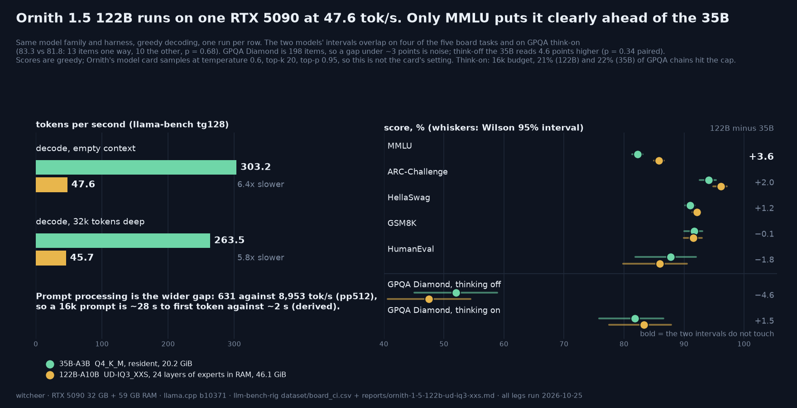

# Ornith 1.5 122B on one RTX 5090: 47.6 tok/s from an offloaded 3-bit cut, and no clear quality edge over the 35B outside MMLU

**TL;DR.** Ornith 1.5 122B-A10B (124.6B parameters, 10B active, 256 experts) does not fit a 32 GB card at any quant. This treatment runs unsloth's `UD-IQ3_XXS` (46.1 GiB) with the routed experts of the first 24 layers in system RAM (`--n-cpu-moe 24`, 59 GB RAM) and everything else on the GPU: **47.6 tok/s** decode (45.7 at 32k depth, 96% held), 631 tok/s prefill, 27.7 GiB (28,336 MiB) VRAM peak at a 16k prompt. Against the Ornith 1.5 35B-A3B Q4_K_M running fully resident at 303 tok/s, that is 6.4x slower decode and 14x slower prefill (a 16k prompt is ~28 s to first token against ~2 s, derived).

What the 122B buys on this board:

1. **MMLU, and little else.** Five-task board (think-off) q_avg **90.34 vs 89.36** for the 35B: +1.0, inside the 1.15-point Wilson half-width of the q_avg row. MMLU is +3.6 (85.83 vs 82.24, intervals do not touch). ARC-Challenge +2.0 and HellaSwag +1.2 have overlapping intervals; GSM8K is level (91.58 vs 91.66); HumanEval is 1.8 points lower (85.98 vs 87.80) inside a ±4.5 interval.
2. **GPQA Diamond does not separate them.** Think-off 47.47 vs 52.02 (94 vs 103 of 198; 31 items only the 122B gets, 40 only the 35B, exact McNemar p = 0.34). Think-on 83.33 vs 81.82 (165 vs 162; 13 vs 10 discordant, p = 0.68). 198 items: a gap under ~3 points is noise. The think-on legs are alike in cost too: 21.2% (122B) and 21.7% (35B) of chains hit the 16k budget, 7,121 and 6,996 completion tokens per correct answer.
3. **HumanEval+ think-on 93.29 vs 91.46** (153 vs 150 of 164; 7 vs 4 discordant, p = 0.55), at 3,587 s of wall against 486 s.

Read together: the 122B is a knowledge-recall gain (MMLU) bought with a 6x decode penalty, on a model file that is also a lower quant (3.06 bpw against Q4_K_M) than the 35B it is compared with. Everything here is greedy; the Ornith model card samples at temperature 0.6, top-k 20, top-p 0.95.

## Setup

- **Hardware:** RTX 5090 32 GB (sm_120), AMD Ryzen 5 9600 (6 cores), 59 GB system RAM, single card, single stream, Donald (the box's resident server) drained for the run and restored by the script's exit trap.
- **Model:** `unsloth/Ornith-1.5-122B-GGUF`, `UD-IQ3_XXS`, 49,515,667,712 bytes (46.10 GiB, 3.06 bpw), sha256 prefix `027a9a48`, byte-matched to the HF file. Base `ornith-ai/Ornith-1.5-122B` (MIT). GGUF header read CPU-only: architecture `qwen35moe`, 49 blocks (48 plus one next-token-prediction block), 256 experts with 8 used, expert FFN 1024, hidden 3072, full attention every fourth layer (12 of 48), 2 KV heads, 899 tensors; llama.cpp reports `qwen35moe 122B.A10B IQ3_XXS`, 124.64 B parameters. The embedded chat template (sha256 prefix `9dd2fbd2`) differs from the 35B's.
- **Build:** llama.cpp `b10371` (`5d16e81dd`), the rig's standing build; the arch loaded without a new build or override.
- **Offload:** `-ngl 99 --n-cpu-moe N`: the routed experts of the first N layers stay in system RAM, everything else is on the GPU. Experts are 41.2 GiB of the file (4.9 GiB is the rest).
- **Quality:** the standing five-task board (MMLU and HellaSwag 50% stratified sample, seed 42; ARC-Challenge, GSM8K and HumanEval full), greedy, **thinking off** via `chat_template_kwargs`, `ctx 8192`, `mc_gate_tokens 400` (the multiple-choice pace gate raised in-process, as for Flash-Next). GPQA Diamond 198 items, zero-shot, deterministic shuffle, greedy: think-off at the class `max_tokens` 2048 (answers are letters, median 2 completion tokens), think-on at `max_tokens` 16384, `ctx 24576`. HumanEval+ think-on, same think-on budget.
- **Speed:** llama-bench `-p 512 -n 128` per offload point for the sweep; then the standing sweep (pp128 to pp16384, tg128) at the optimum plus the depth pass (`-d 0,8192,32768`, `-r 2`) run twice (rep a and b) to record the spread. VRAM sampled at 1 Hz.
- **Comparator (Ornith 1.5 35B-A3B Q4_K_M, 20.2 GiB, fully resident):** `results/ornith-1-5-35b-q4-k-m` (board, speed, GPQA think-off), `ornith-35b-thinkon` (GPQA think-on, 16k), `ornith-1-5-35b-q4-k-m-thinkon` (HumanEval+). Its board and tg128 were measured 2026-08-21/22 on llama.cpp b9653; its depth rows are on the same b10371 build as the 122B. Same eval classes and greedy decoding throughout.
- **Run window:** Sunday 2026-10-25, 09:22 to 22:13 CET in one night-lib script (`scripts/capsule-queue/68-ornith122b.sh`), all six legs inside the weekend heures-creuses block. The ladder of tail legs (MBPP+, MATH-500, IFEval, AIME/HMMT) was off by default and did not run.

## The offload sweep

llama-bench, `-p 512 -n 128`, VRAM peak sampled during the run (this is a short-prompt peak; the speed pass below peaks higher because its largest prompt is 16,384 tokens).

| `--n-cpu-moe` | tg128 tok/s | pp512 tok/s | VRAM peak | note |
|---:|---:|---:|---:|---|
| 34 | 34.3 | 292 | 17.9 GiB | |
| 32 | 37.1 | 468 | 19.8 GiB | |
| 30 | 39.3 | 502 | 21.7 GiB | |
| 28 | 41.9 | 540 | 23.7 GiB | |
| 26 | 43.7 | 583 | 25.6 GiB | |
| **24** | **47.6** | **628** | **27.3 GiB** | optimum under the cap |
| 22 | 51.0 | 679 | 29.0 GiB | over the 28,700 MiB cap |
| 20 | 54.9 | 742 | 30.6 GiB | loads; over the cap, ladder stopped |

Reads:

1. **Near-linear in resident experts, no cliff yet.** Every two layers moved onto the card bought 2 to 4 tok/s (34.3 at 17.9 GiB, 54.9 at 30.6 GiB). Unlike the Flash-Next ladder, decode did not invert before the ladder stopped: the script stopped at its own VRAM cap (a 29,800 MiB peak stops the ladder, 28,700 MiB bounds the optimum) because the board servers need room for a 24,576-token context and four slots. So **n=24 is a headroom choice, not a measured peak**: n=22 and n=20 are faster on a short prompt and were not run through the board or the depth pass.
2. **Quality legs peaked higher than the sweep.** With four slots and the 24,576 context, the think-on legs sampled up to 29,000 MiB of VRAM (board 28,602, HumanEval+ 28,968): the 28,336 MiB speed-pass peak is the 16k-prompt figure used in `card_fit.csv`, not the largest the model reached.
3. **A 32 GB card only.** The 27.7 GiB peak plus headroom leaves no smaller card a measured row; a smaller card would need a larger `--n-cpu-moe`, which the ladder covers only at n=34 (17.9 GiB, 34.3 tok/s). Those are 5090 measurements at a VRAM budget, not measurements on those cards.

## Speed at the optimum (n=24, `UD-IQ3_XXS`)

| test | 122B-A10B, n=24 | 35B-A3B Q4_K_M, resident |
|---|---:|---:|
| pp512 | 631.4 ± 5.8 | 8,953 ± 53 |
| pp16384 | 595.1 ± 0.1 | 8,436 ± 30 |
| tg128 | **47.63 ± 0.11** | **303.21 ± 2.16** |
| pp512 @ d8192 | 594.7 | 8,336 |
| tg128 @ d8192 | 46.24 | 269.68 |
| pp512 @ d32768 | 574.1 | 7,091 |
| tg128 @ d32768 | **45.66** | **263.46** |
| VRAM peak (16k prompt) | 28,336 MiB | 21,394 MiB |

Decode holds 96% of its empty-context speed at 32k depth (35B: 87%): the attention is every fourth layer with 2 KV heads, so context costs little, and the offloaded expert traffic is the same at any depth. Rep a and rep b of the depth pass agree within 0.6% on every cell (`speed.json` `depth_rep_spread_pct`). TTFT for a 16k prompt, derived as 16,384 / pp512 @ 8k, is ~27.6 s (35B ~2.0 s); the Flash-Next report measured 29.4 s against a 19.8 s derivation under offload, so the derived figure is a floor.

## Quality

| task | 122B UD-IQ3_XXS | 35B Q4_K_M | 122B minus 35B | 95% intervals |
|---|---:|---:|---:|---|
| MMLU | **85.83** | 82.24 | +3.6 | 85.00 to 86.63 / 81.33 to 83.12: apart |
| ARC-Challenge | 96.16 | 94.11 | +2.0 | 94.90 to 97.12 / 92.62 to 95.32: overlap |
| HellaSwag | 92.15 | 91.00 | +1.2 | 91.38 to 92.86 / 90.17 to 91.76: overlap |
| GSM8K | 91.58 | 91.66 | −0.1 | 89.96 to 92.96 / 90.04 to 93.03: level |
| HumanEval | 85.98 | 87.80 | −1.8 | 79.83 to 90.47 / 81.91 to 91.97: overlap |
| **q_avg** | **90.34** | 89.36 | +1.0 | 89.19 to 91.49 / 88.26 to 90.47: overlap |
| GPQA Diamond, think-off | 47.47 | 52.02 | −4.6 | 40.63 to 54.41 / 45.09 to 58.87: overlap |
| GPQA Diamond, think-on (16k) | 83.33 | 81.82 | +1.5 | 77.52 to 87.88 / 75.86 to 86.57: overlap |

Parse failures: 10 across the 13,203 multiple-choice answers on the board (MMLU 9, HellaSwag 1), 0 on GSM8K and ARC-Challenge. `board_ci.csv` carries the per-task rows for both models.

Reads:

1. **The board rank is a tie at the q_avg level.** 90.34 puts the 122B between Qwen3.8-27B UD-IQ2_XXS (90.8) and Ling-3.0-flash IQ2_M (90.2) on the think-off table, one point over the 35B, which the row's own half-width (1.15) does not separate from it. MMLU is the one task where the 122B is plainly ahead; that is where total parameters (knowledge) should show, and it does.
2. **GPQA Diamond does not reward the extra parameters here.** Think-off the 122B reads 4.6 points lower; paired on the same 198 items the split is 31 versus 40 discordant (p = 0.34). Think-on the 122B reads 1.5 higher, 13 versus 10 (p = 0.68). Neither is a gap this set can see.
3. **Think-on cost is the same.** 42 of 198 chains hit the 16k budget on the 122B (21.2%, 16 of them still correct), 43 on the 35B (21.7%, 14 correct). Accuracy on chains that finished: 149 of 156 (95.5%) against 148 of 155 (95.5%). Tokens per correct answer 7,121 against 6,996; on the 152 items both solve, the 122B spent 1.06x the completion tokens. The 25,562 s (7.1 h) wall at 47 tok/s is the practical cost: the same leg is 6x faster on the 35B.
4. **HumanEval+ think-on is a small edge at a large time cost.** 153 versus 150 of 164, 7 versus 4 discordant (p = 0.55); 1,040 against 786 completion tokens per correct answer; 3,587 s against 486 s of wall.

## Worth it?

**Worth it if** you want the highest MMLU-style recall this card has produced and can wait: a 122B model from one consumer GPU plus 59 GB of RAM, at 47 tok/s decode and a ~28 s first token on a 16k prompt. **Not worth it if** decode speed, long-prompt latency or reasoning cost matters: on this board the Ornith 35B-A3B Q4_K_M decodes 6.4x faster, prefills 14x faster, fits resident in 20.9 GiB (21,394 MiB peak), and is not separable from the 122B on GPQA Diamond (either mode) or HumanEval. "Get the 35B" is the board's answer; "run the 122B" is a choice for MMLU-shaped knowledge work.

## Honest limits

- One file (`UD-IQ3_XXS`, 3.06 bpw) against a 4.9-bpw 35B file: size and quant move together. A Q4-class 122B cut was not measured.
- Greedy decoding, one pass per cell. Ornith's model card samples at temperature 0.6, top-k 20, top-p 0.95; these are not the card's settings, and sampled mean scores on a reasoning model can differ (the Qwen3.8-27B sampled-AIME pilot published alongside this one moved a 30-problem score by 2.5 points).
- GPQA Diamond is 198 items, one item is ~0.5 points, and gaps under ~3 points are noise. The think-on legs are budget-floored: ~21% of chains hit 16k on both models, so both think-on numbers are floors, not ceilings.
- The 35B's board and tg128 rows are from 2026-08-21/22 on llama.cpp b9653; the 122B rows are b10371. The 35B depth rows are b10371. Same eval classes, same greedy regime; not a same-day pair.
- The sweep stopped at a VRAM cap, not at a decode peak: n=22 and n=20 are faster on a short prompt and were not run through the board.
- Speed rows are conditioned on the offload shape and the host: 59 GB of RAM, a 6-core CPU and its memory bandwidth. A different host moves every decode number. They are not comparable to resident rows' speed in the way the quality rows are.
- HumanEval+ is the only second-tier think-on task run (MATH-500, MBPP+, IFEval and AIME/HMMT were left off the item); the 122B has no row in the second-tier table.
- The embedded next-token-prediction block (2.39 GiB) was counted as resident and not exercised: no speculative-decoding leg was run. No tool-calling leg either (the toolcall-v1 harness is pinned to the Qwen3.8 template).
- `dataset/card_fit.png` was not re-rendered; the new row is in `card_fit.md` and `card_fit.csv`.

## Files

- Rows: `dataset/benchmarks.csv` (7 llama-bench rows), `dataset/board_ci.csv` (7 rows for the think-off slug plus one `gpqa_thinkon` row), `dataset/speed_at_depth.csv`, `dataset/card_fit.md` / `.csv`, the quality-table row and footnote 17 in `dataset/README.md`.
- Chart: `scripts/chart_ornith_122b.py` reads the three csvs above (`python3 scripts/chart_ornith_122b.py`).
- Queue item that ran it: `scripts/capsule-queue/68-ornith122b.sh`.
