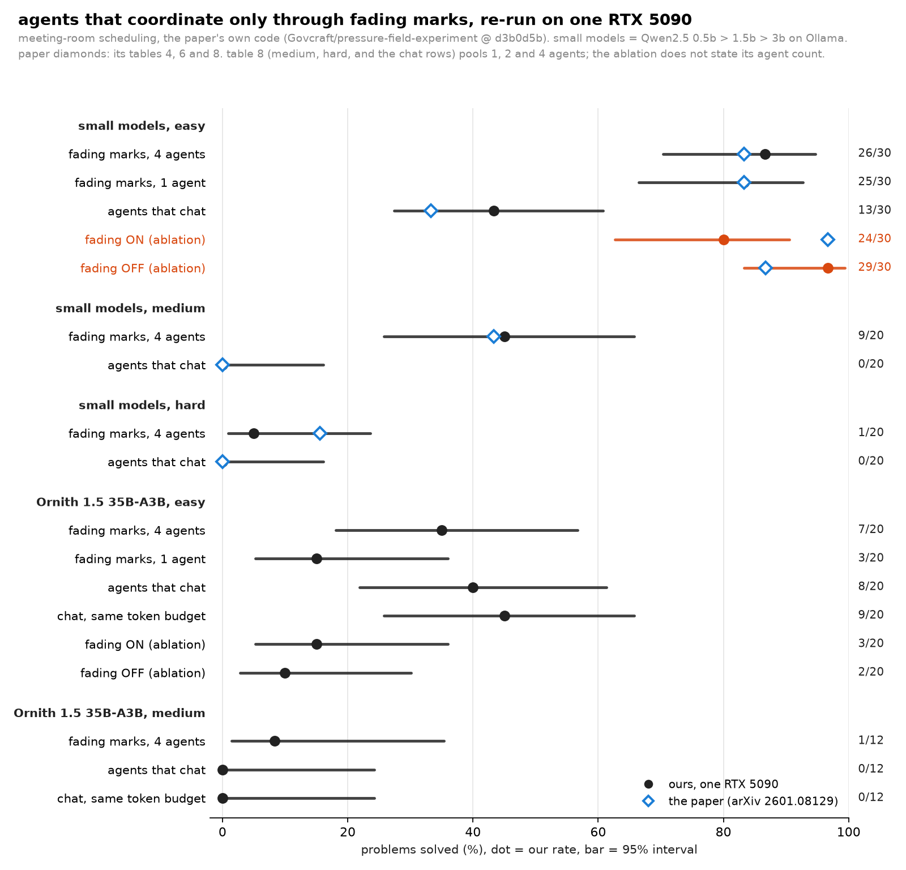

# Fading marks for AI agents, re-run on one RTX 5090

**The one line:** a January paper says AI agents that never message each other and coordinate only through marks that fade on a shared board solve scheduling problems about 4x as often as agents that chat; re-run with the paper's own code and its small Qwen2.5 models, the marks beat the chat (26/30 against 13/30 on easy problems, 9/20 against 0/20 on medium), but switching the fading off did not hurt (29/30 without it, 24/30 with it, inside the noise), one agent did as well as four, and with a 35B model the chat caught up.

**Paper:** "Emergent Coordination in Multi-Agent Systems via Pressure Fields and Temporal Decay", Rodriguez, [arXiv 2601.08129](https://arxiv.org/abs/2601.08129) (v3, 2026-01-29) · **Code:** [Govcraft/pressure-field-experiment](https://github.com/Govcraft/pressure-field-experiment) @ `d3b0d5b`, run unchanged · **Rig:** RTX 5090 32 GB, Ollama 0.24.0 (the paper's runtime) for the Qwen2.5 chain, llama.cpp b11668 (`cd0a5b6a1`) for Ornith · **Window:** 2026-10-31 00:27 to 14:42 CET, 849 min of cell time · **Scripts:** [`pheromone/`](../pheromone/README.md) · **Results:** [`data/pheromone-replay/`](../data/pheromone-replay/)

## TL;DR

1. **The headline holds with the paper's models.** Fading marks with 4 agents solved 26/30 easy problems (the paper's same cell: 25/30) against 13/30 for agents that chat (paper, pooled over 1, 2 and 4 agents: 33.3%). On medium problems 9/20 against 0/20 (paper: 43.3% against 0%).
2. **The fading is not where the win comes from on this card.** The paper's ablation has 29/30 with fading and 26/30 without (it calls fading essential, while noting the gap is not significant). Here the same ablation gave 24/30 with fading and 29/30 without. The intervals overlap, so this is a tie with the direction reversed, not a result.
3. **One agent does as well as four** (25/30 against 26/30), as in the paper's own scaling table (25/30 and 25/30). The method works as a search loop: a scored board points at the worst region, the model proposes a patch, only improving patches are kept.
4. **With a 35B model the chat catches up.** Ornith 1.5 35B-A3B: fading marks 7/20, chat 8/20, chat with the same token budget 9/20. All three overlap.
5. **The marks cost more tokens.** Per trial, fading marks used 2.5x the tokens of chat on easy problems with the small models (272,620 against 111,100), 5.2x on medium (1,054,750 against 201,171) and 4.4x with Ornith on easy (473,070 against 108,367).

## Every cell

95% Wilson intervals. Paper numbers from its tables 4, 6 and 8 (table 8 pools 1, 2 and 4 agents).

| cell | ours | paper | mean tokens per trial |
| --- | --- | --- | --- |
| small models, easy, fading marks, 4 agents | 26/30 (86.7%, 70.3-94.7) | 25/30 (83.3%), table 6 | 272,620 |
| small models, easy, fading marks, 1 agent | 25/30 (83.3%, 66.4-92.7) | 25/30 (83.3%), table 6 | 307,171 |
| small models, easy, agents that chat (4) | 13/30 (43.3%, 27.4-60.8) | 30/90 (33.3%), table 8, pooled 1/2/4 agents | 111,100 |
| small models, easy, ablation: fading on | 24/30 (80.0%, 62.7-90.5) | 29/30 (96.7%), table 4, agent count not stated | 290,924 |
| small models, easy, ablation: fading off | 29/30 (96.7%, 83.3-99.4) | 26/30 (86.7%), table 4 | 228,109 |
| small models, medium, fading marks, 4 agents | 9/20 (45.0%, 25.8-65.8) | 39/90 (43.3%), table 8, pooled | 1,054,750 |
| small models, medium, agents that chat | 0/20 (0.0%, 0.0-16.1) | 0/90, table 8, pooled | 201,171 |
| small models, hard, fading marks, 4 agents | 1/20 (5.0%, 0.9-23.6) | 14/90 (15.6%), table 8, pooled | 1,623,433 |
| small models, hard, agents that chat | 0/20 (0.0%, 0.0-16.1) | 0/90, table 8, pooled | 244,906 |
| Ornith 35B-A3B, easy, fading marks, 4 agents | 7/20 (35.0%, 18.1-56.7) | - | 473,070 |
| Ornith 35B-A3B, easy, fading marks, 1 agent | 3/20 (15.0%, 5.2-36.0) | - | 541,096 |
| Ornith 35B-A3B, easy, agents that chat | 8/20 (40.0%, 21.9-61.3) | - | 108,367 |
| Ornith 35B-A3B, easy, chat with the same token budget (170 ticks) | 9/20 (45.0%, 25.8-65.8) | - | 159,715 |
| Ornith 35B-A3B, easy, ablation: fading on | 3/20 (15.0%, 5.2-36.0) | - | 506,293 |
| Ornith 35B-A3B, easy, ablation: fading off | 2/20 (10.0%, 2.8-30.1) | - | 565,864 |
| Ornith 35B-A3B, medium, fading marks, 4 agents | 1/12 (8.3%, 1.5-35.4) | - | 1,385,998 |
| Ornith 35B-A3B, medium, agents that chat | 0/12 (0.0%, 0.0-24.2) | - | 247,932 |
| Ornith 35B-A3B, medium, chat with the same token budget (280 ticks) | 0/12 (0.0%, 0.0-24.2) | - | 417,642 |

## What was run

- **Task and harness:** the paper's meeting-room scheduling generator, strategies and scoring (`schedule-experiment` from the repo, built unchanged), one `grid` call per cell with its own result file. Easy, medium and hard tiers as defined in the paper's table 2.
- **Small models:** the paper's escalation chain qwen2.5:0.5b > 1.5b > 3b on Ollama (library tags, default quantisation).
- **Ornith arm:** Ornith 1.5 35B-A3B Q4_K_M on llama-server, thinking off (`--reasoning-budget 0`), served under an alias with no size in its name (the harness routes any model name containing 0.5b/1.5b/3b/7b/14b to a fixed vLLM port), listed three times as the escalation chain so it keeps the paper's 50-tick budget (with a one-model chain the fading-marks strategy stops at tick 24 while chat runs to 50).
- **Token-matched chat:** the chat strategy given a tick budget equal to the fading-marks mean tokens per trial divided by chat tokens per tick (170 ticks on easy, 280 on medium).
- **Decay ablation:** the repo's `ablation` command with its configuration list cut to full and no-decay (a separate build of the same commit; the only change is 7 deleted lines in that list).

## Deviations and limits

1. **Hardware:** an RTX 5090 against the paper's RTX 4070 8 GB laptop. Fading and inhibition run on wall-clock seconds (half-life 5 s, cooldown 2 s), so a faster card fades less per tick. This alone could move the ablation.
2. **Trials:** 30 per cell for the small models on easy, 20 elsewhere, 12 for Ornith on medium; agent counts 1 and 4 only; hierarchical, sequential and random baselines not re-run.
3. **Noise:** the same Ornith configuration (fading on, 4 agents, easy) scored 7/20 in one cell and 3/20 in the ablation cell, on different seed sets. Cells of 20 move that much.
4. **Ornith's patches:** a logged probe (one trial, two ticks) shows Ornith follows the patch format, but its schedules break the time blocks (47 wrong-length slots in 222 placements), so its patches are rejected. The 35B tie says as much about this harness's prompts as about the model.
5. **The paper's own numbers disagree in one place:** its abstract gives chat 12.6%, its table 3 gives 30/270 = 11.1%.

## Files

- `data/pheromone-replay/compare.json`: ours against the paper, per cell.
- `data/pheromone-replay/summary.json`, `summary.md`: per cell solved/N, interval, mean ticks, mean tokens (`pheromone/pheromone_summary.py`).
- `data/pheromone-replay/cells/*.json`: the harness's raw output per cell (every trial, tick metrics, tokens).
- `data/pheromone-replay/run-config.json`: runtime versions and server flags.
- `scripts/chart_pheromone_replay.py`: the chart.
