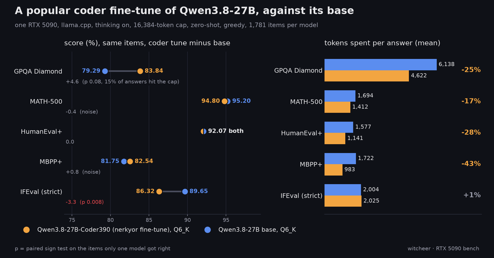

# Qwen3.8-27B-Coder390 vs its base on one RTX 5090: shorter code reasoning at equal accuracy, 3.3 IFEval points lost

**TL;DR.** Qwen3.8-27B-Coder390 (nerkyor's "EfficientThink" SFT + RLOO fine-tune of Qwen3.8-27B, the vendor's own Q6_K-MTP GGUF, 23.2 GB) was run against the banked Qwen3.8-27B Q6_K on the second-tier think-on board: same 1,781 items, same harness build, thinking on, 16,384-token cap, greedy, zero-shot. Three findings. (1) **On code and maths it matches the base and spends fewer tokens getting there:** MATH-500 94.8 vs 95.2, HumanEval+ 92.07 vs 92.07, MBPP+ 82.54 vs 81.75, all inside the noise (paired p 0.79 / 1.0 / 0.63), with mean completion length down 17% / 28% / 43% and the MBPP+ 90th percentile down from 5,468 to 1,499 tokens. (2) **Instruction following is the cost:** IFEval prompt-strict 86.32 vs 89.65, 30 items the base gets right and the tune misses against 12 the other way (paired p 0.008), and the tune does not think shorter there. (3) **GPQA Diamond goes up, directionally:** 83.84 vs 79.29 (15 / 6, p 0.078), at 25% fewer tokens per item, with 29 of 198 tune answers still at the 16k cap (14.6%), so the tune's GPQA number is budget-limited, not a ceiling.

## Setup

- **Hardware:** RTX 5090 32GB (sm_120), single card, single stream, llama-server fully VRAM-resident.
- **Subject:** [`nerkyor/Qwen3.8-27B-Coder390-EfficientThink-Opus5.5-GPT6Astra-Grok4.7-DSV4Pro-K3-SFT-RLOO-MTP-DFlash2`](https://huggingface.co/nerkyor/Qwen3.8-27B-Coder390-EfficientThink-Opus5.5-GPT6Astra-Grok4.7-DSV4Pro-K3-SFT-RLOO-MTP-DFlash2), file `GGUF/Qwen3.8-27B-Coder390-EfficientThink-Q6_K-MTP.gguf`, 23,177,516,384 bytes, sha256 `302597c5...76ab1` (matches the HF LFS sha256; the repo's later commits on 2026-10-15 and 2026-10-18 did not touch this file). Apache-2.0. Card read 2026-10-15.
- **Reference:** the banked `Qwen3.8-27B-Q6_K.gguf` (22,884,408,288 bytes) second-tier row, measured 2026-09-10/11 (IFEval, HumanEval+, MBPP+), MATH-500 regraded 2026-09-14 with the qwen-math grader, GPQA Diamond think-on 2026-08-19 and reproduced to the item on 2026-09-07 and 2026-09-10. Not re-run for this study: same harness, same build, same items, banked results.
- **Server:** ggml-org/llama.cpp `b10371` (`5d16e81dd`), `--n-gpu-layers 99 --jinja`, ctx 24576. **No speculative decoding** on either side: the file's embedded MTP head (15 `blk.64.nextn.*` tensors) is logged as unused on this path, so VRAM and decode speed match the base.
- **Harness:** second-tier think-on lane, `max_tokens 16384`, zero-shot, greedy (`temperature 0` on every request, overriding the file's `general.sampling.*` defaults), one pass per item. IFEval 541 (prompt-strict), MATH-500 500, HumanEval+ 164, MBPP+ 378, GPQA Diamond 198 (deterministic option shuffle, seed 42).
- **Chat template:** the tune's template injects a "Reasoning effort is set to xhigh" system line whenever thinking is on and no `chat_template_kwargs` are sent. The harness sends none, so the tune ran with that line and the base did not. It is the tune's default behaviour and the vendor's own GGUF protocol; read every delta below with it in mind.
- **Run window:** 2026-10-18 17:32 to 2026-10-19 16:53 CEST across three cheap-electricity blocks (idle-queue item `65u-coder390-27b`), GPQA resumed once across a hard stop (resumable progress file, no item re-scored).
- **Params:** 27.32 B written explicitly into each result file; the MTP head inflates the count read from the GGUF.

## Quality

| task | Coder390 Q6_K | Qwen3.8-27B Q6_K | delta | paired (tune-only / base-only) | sign test p |
|---|---:|---:|---:|---:|---:|
| IFEval (prompt-strict) | 86.32 (467/541) | 89.65 (485/541) | **-3.33** | 12 / 30 | **0.008** |
| MATH-500 | 94.8 (474/500) | 95.2 (476/500) | -0.4 | 6 / 8 | 0.79 |
| HumanEval+ | 92.07 (151/164) | 92.07 (151/164) | 0.0 | 5 / 5 | 1.0 |
| MBPP+ | 82.54 (312/378) | 81.75 (309/378) | +0.79 | 10 / 7 | 0.63 |
| **four-task mean** | **88.93** | **89.67** | -0.74 | | |
| GPQA Diamond (second tier, not in the mean) | 83.84 (166/198) | 79.29 (157/198) | +4.55 | 15 / 6 | 0.078 |

p is an exact two-sided sign test on the items only one model answered correctly. The Wilson 95% half-width on the four-task mean is 1.67 (tune) and 1.64 (base), so the mean difference is inside it; the IFEval difference survives the paired test, the others do not. IFEval instruction-level strict accuracy moves the same way: 91.78 (737/803) vs 94.52 (759/803).

## Cost: completion tokens

Per-item completion tokens from each leg's `<task>_tokens.jsonl` (deduplicated by item index; a few retried requests on the tune side are counted once).

| task | mean, tune / base | change | p50, tune / base | p90, tune / base | tokens per correct, tune / base | capped, tune / base |
|---|---:|---:|---:|---:|---:|---:|
| IFEval | 2,025 / 2,004 | +1% | 609 / 807 | 5,407 / 4,666 | 2,345.7 / 2,235.4 | 29 / 15 |
| MATH-500 | 1,412 / 1,694 | -17% | 535.5 / 558.5 | 3,379 / 4,632 | 1,489.0 / 1,779.6 | 7 / 8 |
| HumanEval+ | 1,141 / 1,577 | -28% | 399 / 472.5 | 1,617 / 3,109 | 1,239.8 / 1,712.8 | 4 / 5 |
| MBPP+ | 983 / 1,722 | -43% | 324 / 363 | 1,499 / 5,468 | 1,191.4 / 2,107.0 | 4 / 14 |
| GPQA Diamond | 4,622 / 6,138 | -25% | 1,504 / 2,274.5 | 16,384 / 16,384 | 5,512.5 / 7,740.3 | 29 / 43 |

p90 is nearest-rank. On the items both models solved, the base spends 1.20x (MATH-500, 439 items), 1.67x (HumanEval+, 146), 1.66x (MBPP+, 302), 1.17x (IFEval, 455) and 1.58x (GPQA, 151) the tune's tokens. The saving is mostly in the tail: medians move by 4 to 25%, the code p90s by half or more. Base GPQA tokens come from the 16k leg of the [reasoning-budget curve](reasoning-budget-curve.md) (`results/qwen3-8-27b-q6-k-thinkon/budget-16384/`), whose 198 predictions are identical to the board row's.

## GPQA Diamond, read with the cap

| | Coder390 | base |
|---|---:|---:|
| correct | 166 | 157 |
| misses | 32 | 41 |
| misses that hit the 16k cap | 22 | 35 |
| finished and wrong | 10 | 6 |
| accuracy on answers that finished under the cap | 94.1% | 96.1% |
| capped items (any outcome) | 29 (14.6%) | 43 (21.7%) |

Of the 15 items only the tune gets right, the base hit the cap on 14. The tune's GPQA gain is therefore almost entirely "finishes inside 16k where the base did not", which is the card's efficiency claim showing up as accuracy at this budget. It also means a larger budget would likely narrow the gap, and both rows sit over the 10% capped line: neither number is a ceiling. The card's own GPQA length claim (P50 / P90 3,683 / 27,966 tokens at a 94K cap) is not comparable to a 16k run.

## IFEval, where it loses

The tune caps on 29 IFEval items against the base's 15, and 13 of the 30 base-only items are tune answers that hit the cap. The other 17 finished and broke a constraint; the instructions failed most often on those 30 items are `punctuation:no_comma` (5), `keywords:frequency` (4), `keywords:letter_frequency` (4), `change_case:english_lowercase` (3) and `change_case:english_capital` (3). This is a format-following regression, not a reasoning one, and it is the one difference on this page that clears the paired test.

## Reads

1. The card's central claim, shorter reasoning without losing accuracy, holds on code and maths under this regime: equal scores, 17 to 43% fewer tokens per item, and the long tail cut hardest.
2. It does not hold on IFEval, where the tune thinks about as long as the base and scores 3.3 points lower with p 0.008.
3. The GPQA gain is real on these items but small (p 0.078) and comes from finishing inside the cap; treat it as directional until a 32k pass.
4. Same weights size, same server path, no spec decode: decode speed is the base's. The time saving is the token saving.

## Worth it?

**Worth it if** you run Qwen3.8-27B mainly for code or maths with thinking on: same answers, shorter chains, and on a budget-capped setup the shorter chains turn into GPQA points. **Not worth it if** your work leans on strict output formats (exact casing, banned characters, keyword counts, structured layouts): the base follows those instructions measurably better.

## Honest limits

- One quant (Q6_K), one greedy pass per item. Gaps under ~3 points on 198 GPQA items or ~1 point on the larger sets are noise; only IFEval clears the paired test.
- 16k budget throughout. Both GPQA rows cap over 10% (budget-limited); the vendor's numbers use a 94K budget on their own harness and are not comparable.
- The tune ran with its template's "Reasoning effort is set to xhigh" line (its default); the base template has no such line. No run with the line removed.
- The base row is banked, not re-run: same harness build and items, measured 2026-08-19 to 2026-09-14. The base GPQA leg has been reproduced to the item twice since.
- No think-off board, no speed lane, no MTP or DFlash2 draft test, no tool-call or agentic test here. The MTP head is not loaded on this server path.

## Data

- `dataset/second_tier.csv`: four rows, slug `qwen3-8-27b-coder390-q6-k-mtp`.
- `dataset/board_ci.csv`: one `gpqa_thinkon` row, slug `qwen3-8-27b-coder390-q6-k-mtp-thinkon`, Wilson 95% 78.08 to 88.31.
- Chart script: [`scripts/chart_coder390_vs_base.py`](../scripts/chart_coder390_vs_base.py).
- Raw: `results/qwen3-8-27b-coder390-q6-k-mtp-thinkon/` on the rig (detail, progress and token sidecar per task).
