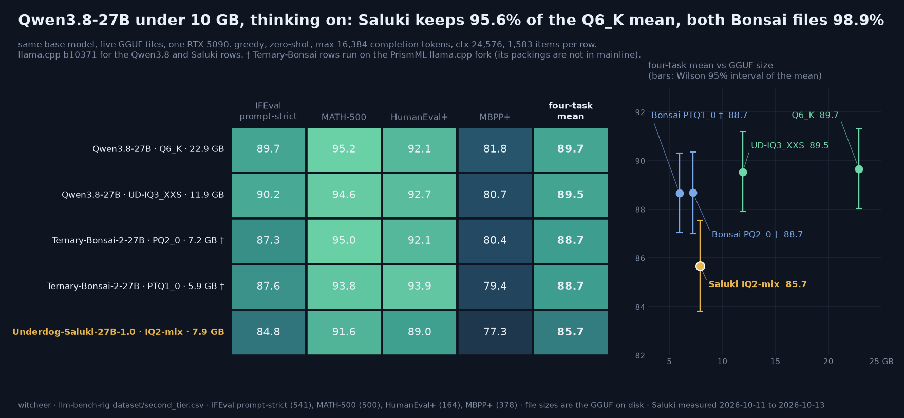

# Qwen3.8-27B under 10 GB, thinking on: Underdog-Saluki-27B against the 3-bit and ternary files

**The one line:** Underdog-Saluki-27B-1.0 (7.9 GB) keeps 95.6% of the Qwen3.8-27B Q6_K four-task mean at a 16k thinking budget; the two Ternary-Bonsai-2-27B files (5.9 and 7.2 GB) keep 98.9% and the 11.9 GB UD-IQ3_XXS 99.9%, and Saluki trails each of them on all four tasks.

**Rig:** RTX 5090 32GB (capsule), llama-server, batch 1 · **Window:** Saluki 2026-10-11 to 2026-10-13, inside the box's cheap-electricity hours (idle-queue item `65s-sub10-core`) · **Harness:** [llm-bench-rig](https://github.com/notwitcheer/llm-bench-rig) second-tier lane, artefacts in `results/<slug>-thinkon/` · **Data:** [`dataset/second_tier.csv`](../dataset/second_tier.csv) · **Chart:** [`sub10-qwen38-27b.png`](sub10-qwen38-27b.png) · **Parent board:** [thinking on at a 16k budget](second-tier-thinkon-16k.md)

## TL;DR

1. **Saluki lands 4.0 points under Q6_K on the four-task mean (85.68 vs 89.67), the only gap on this page wider than the interval.** The propagated Wilson 95% half-width on a four-task mean is 1.6 to 1.9 points per row here, so the Q6_K, UD-IQ3_XXS and both Bonsai rows (88.67 to 89.67) are one band and Saluki sits below it. On the same 1,583 items, Q6_K is right where Saluki is wrong 91 times and the reverse happens 25 times (exact two-sided sign test on the discordant items, p < 0.0001).
2. **The smaller ternary file is ahead too.** Ternary-Bonsai-2-27B PTQ1_0 is 1.95 GB smaller and scores 88.67; paired against Saluki it is right-only on 92 items and wrong-only on 50 (p = 0.0005). The Bonsai files need the PrismML llama.cpp fork; Saluki runs on stock llama.cpp, which is the real difference for anyone on an app built on mainline.
3. **Saluki thinks longer, and the cap catches more of it.** 1.5x to 1.8x the completion tokens per correct answer of Q6_K on every task, 122 of its 1,583 generations reached the 16,384-token cap against 42 for Q6_K, and 104 of its 228 wrong answers were capped. IFEval capped at 9.98%, on the edge of this board's 10% budget-limited flag. The model card says the same in its own words: "with thinking on, it often reasons at length before answering".

## Setup

- **Regime, every row:** thinking on, `max_tokens 16384`, `ctx 24576`, greedy (`temperature 0`), zero-shot, batch 1 through llama-server's chat-completions endpoint. One pass per item; an item cut by a block's hard stop re-ran from scratch at the next block (the tokens sidecars keep both lines, the detail json counts each item once).
- **Tasks:** IFEval (541 prompts, prompt-strict; inst-strict in the detail json), MATH-500 (500, vendored Qwen-Math grader; `grade(r'\frac{1}{2}', '0.5')` printed `True` in the run venv, checked 2026-10-13), HumanEval+ (164, pass@1), MBPP+ (378, pass@1).
- **Subject:** [ConwayResearch/Underdog-Saluki-27B-1.0](https://huggingface.co/ConwayResearch/Underdog-Saluki-27B-1.0), `Underdog-Saluki-27B-1.0-IQ2-mix.gguf`, 7,898,369,152 bytes (`stat -L`). Qwen3.8-27B tuned on top of [ISTA-DASLab/Qwen3.8-27B-GSQ-RCO-GGUF](https://huggingface.co/ISTA-DASLab/Qwen3.8-27B-GSQ-RCO-GGUF), Apache-2.0, a standard GGUF for stock llama.cpp per its card.
- **Comparison rows (already on the 16k board, not re-run):** Qwen3.8-27B Q6_K 22,884,408,288 bytes · Qwen3.8-27B UD-IQ3_XXS 11,913,559,104 · Ternary-Bonsai-2-27B PQ2_0 7,206,168,928 · PTQ1_0 5,946,648,928.
- **Server binaries:** Saluki and both Qwen3.8 rows ran on the rig's mainline llama-server, b10371 (`5d16e81dd`, `config.yaml` `llama_cpp.server_bin`, no override). The two Bonsai rows ran on the PrismML fork (`PrismML-Eng/llama.cpp`, `prism` branch, `4fbda12`, recorded in their detail json's `server_bin`), because PTQ1_0 and PQ2_0 kernels are not in mainline. That is the one condition that differs between rows.
- **Paired comparisons:** per-item `correct` flags from each task's `*_progress.json`, joined on item key; the test is an exact two-sided binomial on the discordant items. Script: [`scripts/sub10_paired.py`](../scripts/sub10_paired.py), run on the rig against the progress files.

## The board

Scores are percentages. `cap` is the share of items whose completion reached the 16,384-token budget, on the task that caps most for that row.

| Model | Quant | GGUF | IFEval | MATH-500 | HumanEval+ | MBPP+ | Mean | vs Q6_K | IFEval cap | MATH-500 tokens / correct |
|---|---|---:|---:|---:|---:|---:|---:|---:|---:|---:|
| Qwen3.8-27B | Q6_K | 22.9 GB | 89.65 | 95.2 | 92.07 | 81.75 | **89.67** | | 2.8% | 1,780 |
| Qwen3.8-27B | UD-IQ3_XXS | 11.9 GB | 90.2 | 94.6 | 92.68 | 80.69 | **89.54** | -0.12 | 3.3% | 1,891 |
| Ternary-Bonsai-2-27B † | PQ2_0 | 7.2 GB | 87.25 | 95.0 | 92.07 | 80.42 | **88.69** | -0.98 | 7.4% | 2,075 |
| Ternary-Bonsai-2-27B † | PTQ1_0 | 5.9 GB | 87.62 | 93.8 | 93.9 | 79.37 | **88.67** | -1.00 | 7.2% | 2,127 |
| Underdog-Saluki-27B-1.0 | IQ2-mix | 7.9 GB | 84.84 | 91.6 | 89.02 | 77.25 | **85.68** | -3.99 | 9.98% | 3,023 |

† PrismML llama.cpp fork `4fbda12`; every other row mainline b10371.

Saluki per task, with Wilson 95% half-widths and the cost columns (all from `dataset/second_tier.csv`):

| Task | Score | Correct / total | ± (95%) | Capped | Tokens / correct | Median completion | vs Q6_K tokens / correct |
|---|---:|---:|---:|---:|---:|---:|---:|
| IFEval prompt-strict | 84.84 | 459 / 541 | 3.0 | 54 (9.98%) | 3,935 | 1,220 | 2,235 |
| MATH-500 | 91.6 | 458 / 500 | 2.4 | 27 (5.4%), 18 unboxed | 3,023 | 704.5 | 1,780 |
| HumanEval+ | 89.02 | 146 / 164 | 4.8 | 12 (7.3%) | 2,748 | 598 | 1,713 |
| MBPP+ | 77.25 | 292 / 378 | 4.2 | 29 (7.7%) | 3,145 | 426.5 | 2,107 |

Paired against each row on identical items (A-only = the comparison row right, Saluki wrong; S-only = the reverse):

| vs | IFEval A-only / S-only | MATH-500 | HumanEval+ | MBPP+ | All four | p (all four) |
|---|---:|---:|---:|---:|---:|---:|
| Qwen3.8-27B Q6_K | 37 / 11 | 22 / 4 | 8 / 3 | 24 / 7 | 91 / 25 | < 0.0001 |
| Qwen3.8-27B UD-IQ3_XXS | 43 / 14 | 22 / 7 | 9 / 3 | 27 / 14 | 101 / 38 | < 0.0001 |
| Ternary-Bonsai-2-27B PQ2_0 | 34 / 21 | 20 / 3 | 10 / 5 | 27 / 15 | 91 / 44 | < 0.0001 |
| Ternary-Bonsai-2-27B PTQ1_0 | 38 / 23 | 19 / 8 | 10 / 2 | 25 / 17 | 92 / 50 | 0.0005 |

## Reads

1. **The direction is the same on every task against every row.** Saluki is below Q6_K by 4.81 (IFEval), 3.6 (MATH-500), 3.05 (HumanEval+) and 4.5 (MBPP+). Single tasks are noisier than the mean: HumanEval+ alone (8 / 3 against Q6_K) is not significant at 164 items. The four-task paired count is what carries the finding.
2. **As a ratio, Saluki keeps 94.5% to 96.7% of the Q6_K score per task, 95.6% of the mean.** The model card's "96% average retention across 9 benchmarks" is against the full-size model on a different task set, so the two are not a pair, but the numbers sit close together. What this page adds is that other files of the same base model keep more on these four tasks: 98.9% (both Bonsai packings) and 99.9% (UD-IQ3_XXS).
3. **A large share of the gap is answers that ran out of budget.** Saluki has 66 fewer correct answers than Q6_K over the four tasks and 80 more capped generations. This does not prove a bigger budget closes the gap (a capped item can be wrong at any budget), but it does mean these scores are partly a 16k-budget read. A 32k pass on the four legs would settle it; it is on the owed list.
4. **IFEval: the widest instruction-group gap is change_case.** 78 of 89 change_case instructions pass for Saluki against 87 of 89 for Q6_K; startend 60 of 67 against 65 of 67. The card names "letter-level instruction puzzles (palindromes, vowel rules, alphabetical order)" as its weakest area; IFEval has no palindrome or vowel instructions, so change_case (all caps, all lowercase) is only the nearest group, not a check of that sentence.
5. **MATH-500 is not competition maths.** 91.6 against 95.2 is 96.2% of Q6_K. The card says Saluki keeps "about 82 to 85% of the full model's competition math score" (AIME); AIME 2026 and HMMT Feb 2026 at a 32k budget are queued for this row and will be the comparable number.

## The model card's claims, checked where this regime can

- **IFEval 93.5 (prompt-loose).** This board grades prompt-strict, a stricter metric: Saluki scores 84.84 prompt-strict and 90.91 inst-strict (730 of 803 instructions). The detail json does not carry a loose score, so the card's number is neither confirmed nor contradicted here. For scale, the same harness gives Q6_K 89.65 prompt-strict and 94.52 inst-strict, so on the strict metrics Saluki is below the base model, where the card's loose figure (93.5) is above its quoted full-size public number (91.5). Different metric, different harness, sampling (the card recommends temperature 0.6 with thinking on; this board is greedy): not a contradiction, but not the same picture either.
- **MBPP+ 78.0.** This board: 77.25 (292 of 378, ± 4.2). Consistent.
- **Tool calling (Underdog Bench, 120 BFCL v4 tasks, thinking off): Saluki 88, full size 84, Bonsai 2 70.** Not run here. The card's comparison with Bonsai 2 is on tool calling; this page measures instruction following, maths and code with thinking on, where the 5.95 GB Bonsai 2 file (PTQ1_0 above, same size) scores 88.67 against Saluki's 85.68. Both can be true; the two measurements answer different questions.
- **Parallel tool calls, SWE-bench Verified, IFBench, MuSR, AIME 2025:** not run here. AIME 2026 is queued (32k, think-on), see Owed.

## Worth it if / not if

- **Worth it if** you need a sub-8 GB Qwen3.8-27B file that loads on stock llama.cpp or an app built on it, and tool calling is your main use: the vendor's tool-calling numbers are the reason to try it, and this page did not measure them.
- **Not if** you can run the PrismML fork: Ternary-Bonsai-2-27B PTQ1_0 is 1.95 GB smaller and 3.0 points higher on these four tasks with thinking on.
- **Not if** the card has 12 GB or more to spare: Qwen3.8-27B UD-IQ3_XXS (11.9 GB) ties the 22.9 GB Q6_K here.
- **Budget note:** with thinking on, Saluki spends 1.5x to 1.8x the tokens per correct answer of Q6_K, so a reply takes longer at the same decode speed.

## Honest limits

- One greedy pass per item, one card. The intervals are sampling intervals, not run-to-run variance. The card recommends temperature 0.6 / top-p 0.95 / top-k 20 with thinking on; greedy decoding is held constant across every row on this board for comparability, and a long-reasoning model can loop more under greedy, which would show up as capping.
- The Bonsai rows ran on a different server binary (PrismML fork); the regime and harness are otherwise identical.
- The comparison rows were measured 2026-09 (Qwen3.8) and 2026-10-08 to 10 (Bonsai), Saluki 2026-10-11 to 13; build, regime and harness held constant.
- No speed or memory measurement here; the file size is the GGUF on disk, not peak VRAM.
- Tool calling, the card's headline, is not measured on this rig.
- ISTA-DASLab GSQ-RCO IQ2_XS (8.42 GB, the base Saluki builds on) is in flight on the same regime; its row is not on this page yet.

## Owed

- ISTA-DASLab/Qwen3.8-27B-GSQ-RCO-GGUF IQ2_XS on the same four tasks (running in the cheap-electricity blocks).
- GPQA Diamond (think-on 16k) and AIME 2026 + HMMT Feb 2026 (think-on 32k) for both sub-10 GB rows (idle-queue item `67-sub10-qwen38-27b`).
- A 32k pass on Saluki's four legs, to measure how much of the gap is the 16k budget.

*Sources: `results/underdog-saluki-27b-iq2-mix-thinkon/{ifeval,math500,humaneval_plus,mbpp_plus}_detail.json` and `*_progress.json` on the rig, read 2026-10-13; `dataset/second_tier.csv` in this commit; model card [ConwayResearch/Underdog-Saluki-27B-1.0](https://huggingface.co/ConwayResearch/Underdog-Saluki-27B-1.0), read 2026-10-13; chart `scripts/chart_sub10_qwen38.py`.*
