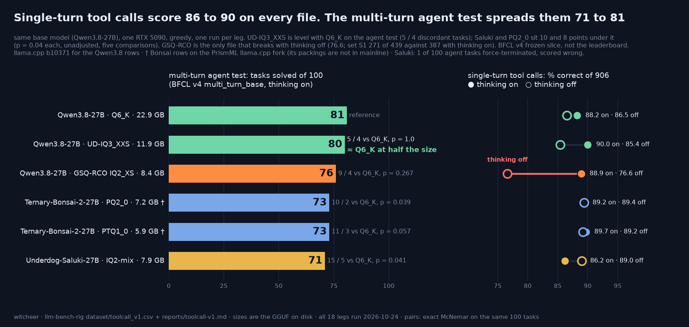

# toolcall-v1: which Qwen3.8-27B file keeps its tool calling? Six files on a frozen BFCL v4 slice

**The one line:** single-turn tool calls land every file between 86.2 and 90.0 with thinking on, the 5.9 GB Ternary-Bonsai-2 file included; a multi-turn agent test spreads the same six files from 71 to 81 tasks solved of 100, with UD-IQ3_XXS (11.9 GB) level with Q6_K (22.9 GB), and the only file that breaks with thinking off is GSQ-RCO IQ2_XS (76.6 against 88.9).

**Rig:** RTX 5090 32GB (capsule), llama-server, batch 1 · **Window:** all 18 legs ran in one idle-queue session, 2026-10-24 07:05 to 18:22 CEST (item `67d-toolcall-v1`); frozen 2026-10-15 before any model output · **Harness:** [`toolcall/`](../toolcall/README.md) in this repo (raw mode, official Qwen3.8 chat template client-side, BFCL's checkers unchanged) · **Data:** [`dataset/toolcall_v1.csv`](../dataset/toolcall_v1.csv) · **Chart:** [`toolcall-v1.png`](toolcall-v1.png)

## TL;DR

1. **The multi-turn test separates the files, the single-turn tests do not line them up by size.** Tasks solved of 100 (BFCL v4 `multi_turn_base`, thinking on, one greedy run): Q6_K 81, UD-IQ3_XXS 80, GSQ-RCO IQ2_XS 76, Ternary-Bonsai-2 PQ2_0 73, PTQ1_0 73, Underdog-Saluki IQ2-mix 71. Single-turn (906 scored items, thinking on): 88.2, 90.0, 88.9, 89.2, 89.7, 86.2. The cheapest file on the board (PTQ1_0, 5.9 GB) scores above Q6_K on the single-turn set and 8 tasks under it on the multi-turn set.
2. **UD-IQ3_XXS and Q6_K are indistinguishable on the agent test; the 2-bit-class files sit 5 to 10 tasks lower.** Paired on the same 100 tasks (Q6_K right only / file right only): UD-IQ3_XXS 5 / 4 (p = 1.0), GSQ-RCO 9 / 4 (p = 0.267), PQ2_0 10 / 2 (p = 0.039), PTQ1_0 11 / 3 (p = 0.057), Saluki 15 / 5 (p = 0.041). All four small files are below Q6_K, none above. Two of those p-values sit just under 0.05 and are unadjusted across five comparisons, so read Saluki and PQ2_0 as suggestive on one greedy run each, not settled.
3. **GSQ-RCO IQ2_XS is the one file that breaks with thinking off.** Single-turn drops from 88.9 to 76.6 (805 to 694 of 906); set S1 (parallel calls) falls from 387 to 271 of 439 and the abstain set S4 from 80 to 69 of 100. Paired on the same 899 requests it is right with thinking on and wrong with it off on 143 items against 31 the other way. No other file loses more than 4.6 points (UD-IQ3_XXS, 90.0 to 85.4); Saluki and both Bonsai files score within half a point of their thinking-on number or higher with thinking off.

## Setup

- **Slice:** a frozen subset of BFCL v4 (`bfcl-eval` 2026.3.23, gorilla `6ea57973`), list and manifest hashed in [`toolcall/toolcall-v1/FROZEN.sha256`](../toolcall/toolcall-v1/FROZEN.sha256) on 2026-10-15 06:40 UTC, before any model output (seed 20261015). It is a slice, not the BFCL leaderboard: S1 parallel pile-up 439 (all of `parallel`, `parallel_multiple`, `live_parallel`, `live_parallel_multiple`), S2 nested schemas 67, S3 call-formation controls 300 (seeded 200 non-nested `simple_python` + 100 `multiple`), S4 abstain 100 (seeded `irrelevance`; correct means no call), S5 multi-turn 100 entries of `multi_turn_base` (phase 1, stratified on ground-truth calls per entry; 100 more are held in reserve and not run). One item was excluded before the freeze (`parallel_multiple_21`: its ground truth passes a string to an array-typed parameter that no schema-typed call can express).
- **Scoring convention:** single-turn totals are S1 + S2 + S3 + S4 = 439 + 67 + 300 + 100 = **906 scored items**. They come from 899 unique requests: 7 nested-schema items sit in both S1 and S2 (one reply, graded under both sets). On the 899 unique requests the percentages move by 0.1 to 0.2 points (the `unique_correct` and `unique_requests` columns of the csv); the paired single-turn tests below use the 899.
- **Raw mode:** the prompt is rendered client-side with the official Qwen3.8 chat template (Qwen/Qwen3.8-27B @ `1d4bf0f2`, template sha256 `c3cf9e34...`), sent as one string to llama-server `/completion` (temperature 0, one request at a time), parsed by [`toolcall/qwen38_xml.py`](../toolcall/qwen38_xml.py) and graded by BFCL's own checkers. The server only tokenises, runs kernels and samples, so every file gets byte-identical prompts and one parser. Tokenisation parity against the HF tokenizer: 1,998 of 1,998 prompts identical on both binaries. The four vendor GGUFs that embed the official template match it byte for byte; the two unsloth files embed a patched template that renders all 1,998 frozen prompts identically to the official one ([`toolcall/artifacts/`](../toolcall/artifacts/)).
- **Parser decision (2026-10-15, after a 9-minute plumbing probe, before the scored legs):** a boolean parameter written exactly `True` / `False` (Python style, what several files emit) decodes as a boolean and carries a `python_bool` flag; anything else (`TRUE`, `yes`) stays malformed. The headline uses this parser (`toolcall-v1-parser-2`). The python-boolean reply count per leg is a format-adherence column in the csv and in the table below. Under the first parser those replies would have counted as malformed. Round-trip of all 799 S1 to S3 ground-truth call sets through the template: 799 of 799, 21 of 21 negative controls.
- **Regimes:** `st-on` and `st-off` are S1 to S4 with thinking on / off, `max_tokens 16384`, `ctx 24576`; `s5-on` is S5 with thinking on, `max_tokens 16384`, `ctx 40960`. Greedy, one run per leg, `preserve_thinking` left at its default. S5 is run with thinking on only. No leg had a transport error; the longest single-turn prompt is 6,140 tokens.
- **Files:** Qwen3.8-27B Q6_K 22,884,408,288 bytes and UD-IQ3_XXS 11,913,559,104 (unsloth), Underdog-Saluki-27B-1.0 IQ2-mix 7,898,369,152 ([ConwayResearch](https://huggingface.co/ConwayResearch/Underdog-Saluki-27B-1.0)), Qwen3.8-27B GSQ-RCO IQ2_XS 8,422,841,472 ([ISTA-DASLab](https://huggingface.co/ISTA-DASLab/Qwen3.8-27B-GSQ-RCO-GGUF)), Ternary-Bonsai-2-27B PQ2_0 7,206,168,928 and PTQ1_0 5,946,648,928 ([prism-ml](https://huggingface.co/prism-ml/Ternary-Bonsai-2-27B-gguf)); all `stat -L`.
- **Server binaries:** the four Qwen3.8-family files ran on mainline llama.cpp b10371 (`5d16e81dd`); the two Bonsai files ran on the PrismML fork (`PrismML-Eng/llama.cpp`, `prism` branch, `4fbda12`) because their packings are not in mainline. Both are recorded per leg in the csv's `server_bin` column. That is the one condition that differs between rows.
- **Paired tests:** exact two-sided binomial on the discordant items, per-item outcomes from each leg's `summary.json` (S5) and `items.jsonl` (single-turn), joined on BFCL id. Script: [`scripts/toolcall_v1_table.py`](../scripts/toolcall_v1_table.py), run on the rig; chart [`scripts/chart_toolcall_v1.py`](../scripts/chart_toolcall_v1.py).

## The board

| File | GGUF | Single-turn, thinking on | Single-turn, thinking off | Multi-turn (S5, thinking on) | S5 Wilson 95% | S5 vs Q6_K (Q6_K-only / file-only) | p |
|---|---:|---:|---:|---:|---:|---:|---:|
| Qwen3.8-27B Q6_K | 22.9 GB | 88.2 (799 / 906) | 86.5 (784 / 906) | **81** / 100 | 72.2 to 87.5 | reference |  |
| Qwen3.8-27B UD-IQ3_XXS | 11.9 GB | 90.0 (815 / 906) | 85.4 (774 / 906) | **80** / 100 | 71.1 to 86.7 | 5 / 4 | 1.0 |
| Qwen3.8-27B GSQ-RCO IQ2_XS | 8.4 GB | 88.9 (805 / 906) | 76.6 (694 / 906) | **76** / 100 | 66.8 to 83.3 | 9 / 4 | 0.267 |
| Ternary-Bonsai-2-27B PQ2_0 † | 7.2 GB | 89.2 (808 / 906) | 89.4 (810 / 906) | **73** / 100 | 63.6 to 80.7 | 10 / 2 | 0.039 |
| Ternary-Bonsai-2-27B PTQ1_0 † | 5.9 GB | 89.7 (813 / 906) | 89.2 (808 / 906) | **73** / 100 | 63.6 to 80.7 | 11 / 3 | 0.057 |
| Underdog-Saluki-27B-1.0 IQ2-mix | 7.9 GB | 86.2 (781 / 906) | 89.0 (806 / 906) | **71** / 100 | 61.5 to 79.0 | 15 / 5 | 0.041 |

† PrismML fork `4fbda12`. Wilson intervals on 100 tasks are about 15 points wide and overlap across the whole 71 to 81 range, so it is the paired counts, not the intervals, that carry the S5 reads below.

### Single-turn, per set

| File | Thinking | S1 parallel (439) | S2 nested (67) | S3 controls (300) | S4 abstain (100) | Total (906) | Python-style booleans | Capped |
|---|---|---:|---:|---:|---:|---:|---:|---:|
| Qwen3.8-27B Q6_K | on | 384 | 57 | 279 | 79 | 799 | 77 | 0 |
| Qwen3.8-27B Q6_K | off | 357 | 61 | 292 | 74 | 784 | 78 | 0 |
| Qwen3.8-27B UD-IQ3_XXS | on | 394 | 57 | 284 | 80 | 815 | 64 | 0 |
| Qwen3.8-27B UD-IQ3_XXS | off | 357 | 54 | 285 | 78 | 774 | 57 | 0 |
| Qwen3.8-27B GSQ-RCO IQ2_XS | on | 387 | 57 | 281 | 80 | 805 | 49 | 0 |
| Qwen3.8-27B GSQ-RCO IQ2_XS | off | 271 | 60 | 294 | 69 | 694 | 55 | 0 |
| Ternary-Bonsai-2-27B PQ2_0 † | on | 389 | 57 | 283 | 79 | 808 | 81 | 1 |
| Ternary-Bonsai-2-27B PQ2_0 † | off | 390 | 60 | 289 | 71 | 810 | 76 | 0 |
| Ternary-Bonsai-2-27B PTQ1_0 † | on | 394 | 58 | 282 | 79 | 813 | 79 | 1 |
| Ternary-Bonsai-2-27B PTQ1_0 † | off | 389 | 60 | 289 | 70 | 808 | 76 | 0 |
| Underdog-Saluki-27B-1.0 IQ2-mix | on | 373 | 54 | 273 | 81 | 781 | 66 | 2 |
| Underdog-Saluki-27B-1.0 IQ2-mix | off | 379 | 61 | 289 | 77 | 806 | 53 | 0 |

"Python-style booleans" counts replies (of 899) where a boolean parameter was written `True` / `False` and decoded under the parser-2 rule. Capped is replies that reached 16,384 tokens (at most 2 per leg).

### Single-turn, paired against Q6_K (899 unique requests)

| File | Thinking on: Q6_K-only / file-only | p | Thinking off: Q6_K-only / file-only | p |
|---|---:|---:|---:|---:|
| Qwen3.8-27B UD-IQ3_XXS | 13 / 29 | 0.020 | 49 / 40 | 0.40 |
| Qwen3.8-27B GSQ-RCO IQ2_XS | 24 / 31 | 0.42 | 116 / 26 | < 0.0001 |
| Ternary-Bonsai-2-27B PQ2_0 † | 17 / 26 | 0.22 | 28 / 54 | 0.005 |
| Ternary-Bonsai-2-27B PTQ1_0 † | 16 / 29 | 0.072 | 29 / 53 | 0.011 |
| Underdog-Saluki-27B-1.0 IQ2-mix | 38 / 21 | 0.036 | 32 / 53 | 0.029 |

## Reads

1. **Single-turn tool calling does not rank these files by size or by agent score.** With thinking on all six sit in a 3.8-point band, the binomial standard deviation at ~89% on 906 items is about 1 point, and the order is not the size order: PTQ1_0 (5.9 GB) 89.7 and UD-IQ3_XXS 90.0 are above Q6_K 88.2. Paired against Q6_K with thinking on, UD-IQ3_XXS is ahead (13 / 29, p = 0.020) and Saluki behind (38 / 21, p = 0.036); those are 2 of the 5 thinking-on comparisons and neither survives a correction for five. With thinking off, Q6_K (86.5) is itself passed by Saluki, PQ2_0 and PTQ1_0 (p = 0.029, 0.005, 0.011, unadjusted). Treat single-turn accuracy on this slice as a check that a file can form a call, not as a ranking.
2. **The multi-turn test is where the files separate.** Q6_K 81 and UD-IQ3_XXS 80 with 5 / 4 discordant tasks is the clearest tie on the page. The four small files all score below Q6_K, by 5 (GSQ-RCO), 8 (PQ2_0, PTQ1_0) and 10 (Saluki). The two at p ≈ 0.04 (Saluki 15 / 5, PQ2_0 10 / 2) are unadjusted across five comparisons; with a correction none stands alone. What is robust is the direction: four of four small files below the reference, none above it.
3. **Between the small files, nothing is measurable.** Paired on S5 (first-named only / second-named only): Saluki against GSQ-RCO 8 / 13 (p = 0.38), PQ2_0 against Saluki 10 / 8 (p = 0.81), UD-IQ3_XXS against GSQ-RCO 10 / 6 (p = 0.45). Saluki's tuning, aimed at tool calling, does not show as a gain over its base file here: 71 against 76 on S5 and 86.2 against 88.9 single-turn with thinking on (with thinking off it is the other way: 89.0 against 76.6).
4. **GSQ-RCO needs its thinking on.** Without it the parallel-call set S1 collapses (271 of 439 against 387) and it calls a tool on 31 of 100 irrelevance prompts (69 correct abstentions against 80). Its S5 leg ran with thinking on, so this failure does not show in the 76. Anyone running GSQ-RCO with thinking off in an agent should expect it to look worse than this page's agent number. Saluki and the two Bonsai files score 89.0, 89.4 and 89.2 with thinking off (86.2, 89.2 and 89.7 with it on).
5. **The model card's tool-calling claim points the same way on one cell, and this is not a replication.** The Saluki card reports 88 against 84 for the full-size model on a 120-task BFCL v4 set with thinking off and temperature 0 (read 2026-10-25). Here, thinking off, Saluki scores 89.0 and Q6_K 86.5 (paired 32 / 53, p = 0.029), a similar direction on a different slice and a different reference file (the card compares to the 54 GB model, this page to Q6_K). The card does not test multi-turn, where Saluki is the lowest row on this page.

## Worth it if / not if

- **Worth it if** you run a Qwen3.8-27B file as the model behind an agent loop with tool results fed back in and can spend 11.9 GB on the file: UD-IQ3_XXS matched Q6_K here at about half the size.
- **Worth it if** you only need single-shot tool calls (one request, one call set), any of the six files is a fair choice on this slice with thinking on, down to the 5.9 GB Bonsai file on the PrismML fork.
- **Not if** you need the multi-turn agent score of Q6_K from a file under 9 GB: the 5.9 to 8.4 GB files here score 71 to 76 against 81, one greedy run each.
- **Not if** you run GSQ-RCO IQ2_XS with thinking off.
- This is BFCL's multi-turn base set driven by this harness, not Hermes Agent: no Hermes session was run, so the page says nothing about Hermes' own tool schemas or prompts.

## Honest limits

- Greedy, one run per leg. The paired tests treat each task as one independent draw; they carry no run-to-run variance. 100 multi-turn tasks give an interval about 15 points wide per file.
- BFCL v4 frozen slice (list in `toolcall/toolcall-v1/`), not the full leaderboard and not the vendors' task sets. S2 and S3 follow BFCL's call checker; S5 follows `multi_turn_base` with BFCL's state checker.
- S5 was run with thinking on only; thinking off was run on the single-turn sets only.
- The Bonsai rows run on the PrismML fork (`server_bin` in the csv); everything else is identical, including prompts and parser.
- One Saluki S5 task (`multi_turn_base_43`) hit BFCL's per-turn step limit (force-quit) and is scored wrong, as BFCL scores it; one more (`multi_turn_base_171`) was cut by the 40,960 context mid-reasoning (33,284 prompt + generated tokens at its peak) and is wrong. PQ2_0 had one context-limited task too (`multi_turn_base_16`, 40,958). Each of these costs the row at most one task out of 100.
- Parser-2 counts Python-style booleans as correct; the python-boolean column shows how often each file does it (49 to 81 of 899 replies per leg). Under the first parser those replies were counted malformed, and the rate differs between files.
- The single-turn percentages use 906 scored items drawn from 899 unique requests (see Setup).
- The 100 phase-2 S5 entries were held in reserve and not run; they are not a replication set for this run.

*Sources: `results/toolcall-v1/<slug>-{st-on,st-off,s5-on}/summary.json` and `items.jsonl` on the rig (18 legs), read 2026-10-25; `dataset/toolcall_v1.csv` in this commit; frozen list and hashes in `toolcall/toolcall-v1/`; GGUF sizes from the queue item's `ROWS=` block ([`toolcall/67d-toolcall-v1.sh`](../toolcall/67d-toolcall-v1.sh)); Saluki model card read 2026-10-25.*
